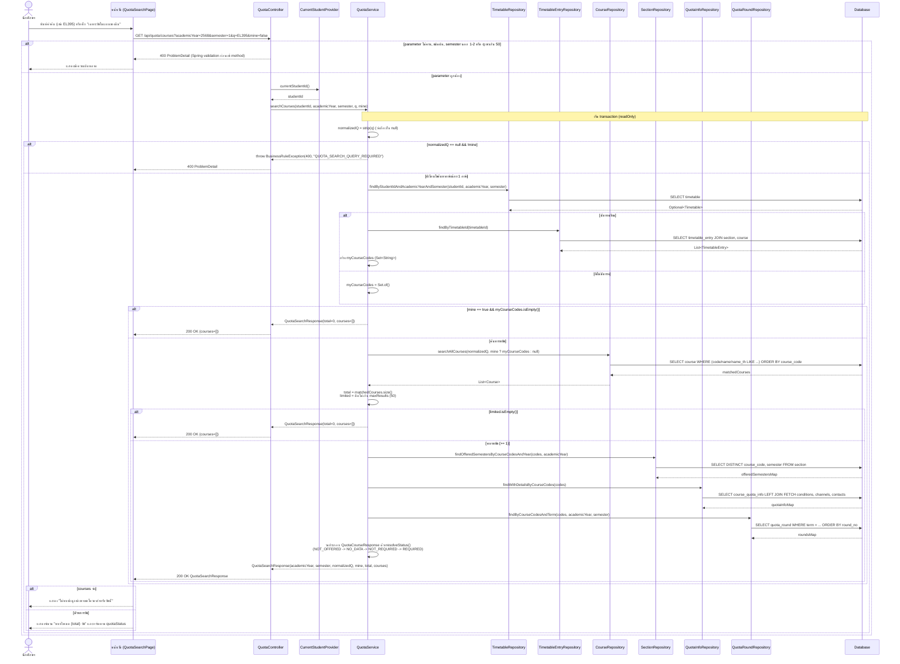

# US7-T06 — Sequence Diagram: ค้นหาช่องทางขอโควตา

ลำดับการทำงานระหว่างหน้าเว็บ (UI), Controller, Service, Repository (DAO) และ Database สำหรับ `GET /api/quota/courses?academicYear=&semester=&q=&mine=` ตาม [DTO & API Spec](../T05/US7-DTO-API-Spec.md) และ [Extended API Class Diagram](./US7-T06-Extended-API-Class-Diagram.md)

## เอกสารที่เกี่ยวข้อง

- [ER Diagram](./US7-T06-ER-Diagram.md)
- [DAO Class Diagram](./US7-T06-DAO-Class-Diagram.md)
- [Extended API Class Diagram](./US7-T06-Extended-API-Class-Diagram.md)
- [Sequence Diagram — Detail](./US7-T06-Sequence-Diagram-Detail.md)
