# US8 — API Class Diagram

```mermaid
classDiagram
    direction TB

    class StudyPlanController {
        <<US8 RestController>>
        -studyPlanService: StudyPlanService
        -currentStudentProvider: CurrentStudentProvider
        +getPlans(studyYear: int, semester: int) StudyPlanListResponse
    }
    class ApplyPlanController {
        <<US8 RestController>>
        -applyPlanService: ApplyPlanService
        -currentStudentProvider: CurrentStudentProvider
        +applyPlan(request: ApplyPlanRequest) ApplyPlanResponse
    }
    class StudyPlanService {
        <<US8 Service>>
        -studyPlanRepository: StudyPlanRepository
        -studyMinorRepository: StudyMinorRepository
        -userRepository: UserRepository
        +getPlans(studentId: String, studyYear: int, semester: int) StudyPlanListResponse
    }
    class ApplyPlanService {
        <<US8 Service>>
        -studyPlanRepository: StudyPlanRepository
        -studyMinorRepository: StudyMinorRepository
        -sectionRepository: SectionRepository
        -timetableRepository: TimetableRepository
        -timetableEntryRepository: TimetableEntryRepository
        -timetableService: TimetableService
        -planScheduler: PlanScheduler
        -maxCredits: int
        +applyPlan(studentId: String, request: ApplyPlanRequest) ApplyPlanResponse
        -loadMinor(minorId: Long, plan: StudyPlan) StudyMinor
        -loadCandidates(plan: StudyPlan, minor: StudyMinor, academicYear: int) List~PlanCourseCandidate~
        -saveAdded(studentId: String, plan: StudyPlan, academicYear: int, sections: List~Section~) void
    }
    class PlanScheduler {
        <<US8 Component · ไม่ใช้ DB>>
        -maxNodes: int
        +schedule(candidates: List~PlanCourseCandidate~, existing: List~Section~, maxCredits: int) ScheduleResult
        -groupByTimePattern(sections: List~Section~) List~Section~
        -greedy(state: SearchState) SearchState
        -search(depth: int, state: SearchState) void
        -upperBound(depth: int, state: SearchState) Score
        -summarize(best: SearchState) ScheduleResult
    }
    class PlanCourseCandidate {
        <<US8 record · ภายใน>>
        -course: Course
        -source: PlanCourseSource
        -planOrder: int
        -sections: List~Section~
    }
    class ScheduleResult {
        <<US8 record · ภายใน>>
        -added: List~Section~
        -skipped: List~SkippedPlanCourseResponse~
    }
    class ScheduleOverlap {
        <<US1 refactor · utility>>
        +overlaps(a: ScheduleSlot, b: ScheduleSlot)$ boolean
        +conflicts(a: Section, b: Section)$ boolean
    }
    class StudyPlanRepository {
        <<US8 Repository>>
        +findByDepartmentAndStudyYearAndSemester(department: String, studyYear: int, semester: int) List~StudyPlan~
        +findWithCoursesById(planId: Long) Optional~StudyPlan~
    }
    class StudyMinorRepository {
        <<US8 Repository>>
        +findByDepartmentAndTerm(department: String, studyYear: int, semester: int) List~StudyMinor~
        +findWithCoursesById(minorId: Long) Optional~StudyMinor~
    }
    class BusinessRuleException {
        <<มีอยู่แล้ว · status + code>>
        +BusinessRuleException(status: HttpStatus, code: String, detail: String, properties: Map)
    }
    class SectionRepository {
        <<US1 มีอยู่แล้ว>>
        +findByCourseCodesAndTerm(courseCodes: Collection~String~, academicYear: int, semester: int) List~Section~
    }
    class TimetableService {
        <<US1 Service>>
        +getTimetable(studentId: String, academicYear: int, semester: int) TimetableResponse
    }
    class UserRepository {
        <<US3 มีอยู่แล้ว>>
        +findById(studentId: String) Optional~User~
    }
    class CurrentStudentProvider {
        <<US1 interface>>
        +currentStudentId() String
    }
    class ResourceNotFoundException {
        <<มีอยู่แล้ว · 404>>
        +ResourceNotFoundException(message: String)
    }
    class GlobalExceptionHandler {
        <<มีอยู่แล้ว ไม่แก้>>
        +handleNotFound(ex: ResourceNotFoundException) ProblemDetail
        +handleBusinessRule(ex: BusinessRuleException) ProblemDetail
        #handleMethodArgumentNotValid(...) ResponseEntity
    }
    class studyPlanApi {
        <<US8 frontend module>>
        +getPlans(query: StudyPlanQuery) Promise~StudyPlanList~
        +applyPlan(request: ApplyPlanRequest) Promise~ApplyPlanResponse~
    }
    class apiFetch {
        <<lib/api.ts มีอยู่แล้ว>>
        +apiFetch(path: string, init: RequestInit) Promise~T~
    }

    studyPlanApi ..> apiFetch : เรียก
    apiFetch ..> StudyPlanController : GET /api/study-plans
    apiFetch ..> ApplyPlanController : POST /api/timetable/apply-plan
    StudyPlanController --> StudyPlanService
    StudyPlanController --> CurrentStudentProvider
    ApplyPlanController --> ApplyPlanService
    ApplyPlanController --> CurrentStudentProvider
    StudyPlanService --> StudyPlanRepository
    StudyPlanService --> UserRepository : อ่าน department
    StudyPlanService --> StudyMinorRepository : วิชาโทของภาค
    ApplyPlanService --> StudyPlanRepository
    ApplyPlanService --> StudyMinorRepository : วิชาโทที่เลือก
    ApplyPlanService ..> BusinessRuleException : throws MINOR_NOT_ALLOWED / MINOR_PLAN_MISMATCH
    GlobalExceptionHandler ..> BusinessRuleException : จัดการ
    ApplyPlanService --> SectionRepository : section ของภาคที่ขอ
    ApplyPlanService --> PlanScheduler
    ApplyPlanService --> TimetableService : getTimetable() หลังบันทึก
    ApplyPlanService ..> PlanCourseCandidate : สร้าง
    PlanScheduler ..> PlanCourseCandidate : รับ
    PlanScheduler ..> ScheduleResult : คืน
    PlanScheduler ..> ScheduleOverlap : ตรวจเวลาชน
    TimetableService ..> ScheduleOverlap : ตรวจเวลาชน (แทนโค้ดเดิม)
    StudyPlanService ..> ResourceNotFoundException : throws
    ApplyPlanService ..> ResourceNotFoundException : throws
    GlobalExceptionHandler ..> ResourceNotFoundException : จัดการ
```

US8 เพิ่ม package ใหม่ `studyplan` ฝั่ง backend (controller 2 ตัว, service 2 ตัว และ `PlanScheduler`) กับโมดูลเรียก API ฝั่ง frontend แผนภาพวาด class ของ US8 (`<<US8>>`) กับจุดที่พึ่ง US1 / US3 และของที่มีอยู่แล้ว โดย**ไม่แก้** `TimetableController` และ `GlobalExceptionHandler`

| ส่วน | หน้าที่ |
| --- | --- |
| `StudyPlanController` | `@RestController @RequestMapping("/api/study-plans")` · `getPlans` = `GET` ตอบ `200` รับ `@RequestParam @Min(1) @Max(4) studyYear` และ `@RequestParam @Min(1) @Max(2) semester` ค่าผิด/ไม่ส่ง → 400 ผ่าน handler เดิม (ดูหัวข้อ "Validation ของ query param") **ห้ามใส่ `@Validated` ที่ class** |
| `ApplyPlanController` | `@RestController @RequestMapping("/api/timetable")` · `applyPlan` = `POST /apply-plan` รับ `@Valid @RequestBody` ตอบ `200` ทั้งสองโหมด แยกจาก `TimetableController` ของ US1 แบบเดียวกับ `TimetableDeleteController` ของ US2 |
| `StudyPlanService` | `@Transactional(readOnly = true)` · หา `User` จาก `studentId` (ไม่พบ → 404) แล้วค้น preset ด้วย `department` + `studyYear` + `semester` แปลงด้วย `StudyPlanResponse.of` · ปี 3–4 ได้ preset ทุกแผน (`SPECIAL_PROJECT`, `CO_OP`) กลับไปพร้อมกัน ไม่รับ `planType` เป็น param ให้ frontend กรองเอง เรียงตาม `curriculumName` แล้ว `planType` · ดึงวิชาโทของภาคด้วย `studyMinorRepository.findByDepartmentAndTerm` แปลงด้วย `StudyMinorResponse.of` ใส่ใน `minors` |
| `ApplyPlanService` | `@Transactional` · ขั้นตอน: หา preset (ไม่พบ → 404) → ถ้ามี `minorId` เรียก `loadMinor` (`plan.studyYear` เป็น 1–2 → `BusinessRuleException(400, "MINOR_NOT_ALLOWED")`, ไม่พบ → 404, `department`/`curriculumName` ไม่ตรงกับ preset → `BusinessRuleException(400, "MINOR_PLAN_MISMATCH")`) → `loadCandidates` รวมวิชาของแผน (`PLAN`) กับวิชาโทของ `plan.studyYear` + `plan.semester` (`MINOR`, ตัดตัวที่ซ้ำกับแผน) แล้วดึง section ของทุกวิชาด้วย `findByCourseCodesAndTerm` ครั้งเดียว และ entry เดิมของ `(studentId, academicYear, plan.semester)` → `planScheduler.schedule()` → ถ้า `dryRun` คืนผลพร้อม `timetable: null` → ไม่เช่นนั้น `saveAdded` (สร้าง `Timetable` ถ้ายังไม่มี, `touch()`, บันทึก entry) แล้วคืน `timetableService.getTimetable()` · `maxCredits` ฉีดจาก `app.timetable.max-credits` ค่าเดียวกับ US1 |
| `PlanScheduler` | อัลกอริทึม backtracking ตาม Spec ทั้ง 3 ขั้น · ไม่มี repository เป็น field จึง unit test ได้โดยไม่มี DB · `maxNodes` ฉีดจาก `app.study-plan.max-search-nodes` (default `50000`) test ตั้งค่าต่ำได้ผ่าน constructor |
| `PlanScheduler.search` | วางทีละวิชาตามลำดับ "กลุ่มเวลาน้อยก่อน" ลองทุกกลุ่มเวลาที่ไม่ชนและหน่วยกิตไม่เกิน แล้วลอง "ข้าม" เป็นทางเลือกสุดท้าย ตัดกิ่งด้วย `upperBound` นับ node จนถึง `maxNodes` |
| `PlanCourseCandidate`, `ScheduleResult` | record ภายใน package `studyplan` ไม่ส่งออกผ่าน API ใช้ส่งข้อมูลระหว่าง `ApplyPlanService` กับ `PlanScheduler` วิชาที่ `sections` ว่างจะได้ `NO_SECTION_AVAILABLE` · `source` ใช้ในเกณฑ์ "ดีที่สุด" (นับวิชา `PLAN` ก่อน `MINOR`) และส่งต่อไปที่ `added`/`skipped` |
| `StudyMinorRepository` | repository ใหม่ · `findByDepartmentAndTerm` คืนวิชาโทของสาขาที่มีวิชาใน `studyYear` + `semester` นั้น พร้อมวิชาเฉพาะของภาคนั้น เรียงตาม `sortOrder` · `findWithCoursesById` โหลดวิชาทุกภาคของวิชาโท แล้ว `ApplyPlanService` กรองตามภาคของ preset รายละเอียด query เป็นงาน US8-T06 |
| `ScheduleOverlap` (refactor US1) | ย้ายสูตร `a.startTime < b.endTime && b.startTime < a.endTime` (วันเดียวกัน) ออกจาก `TimetableService.findConflicts` มาเป็น static utility ใน package `timetable` ให้ US1 และ US8 ใช้ร่วมกัน ทีมตกลงแล้ว ทำเป็น PR refactor แยกก่อนเริ่ม US8 ตาม CONTRIBUTING และ test ของ US1 ต้องผ่านเหมือนเดิม |
| `StudyPlanRepository` | repository ใหม่ `findWithCoursesById` ใช้ `@EntityGraph` โหลดวิชาใน preset มาพร้อมกัน (`open-in-view: false`) รายละเอียด query เป็นงาน US8-T06 |
| `studyPlanApi` | `frontend/features/study-plan/api.ts` · `getPlans` ต่อ `studyYear` / `semester` เป็น query string (ไม่ส่ง `planType` หน้า modal กรอง `plans` ตามปุ่มแผนที่เลือกเอง) · `applyPlan` ส่ง JSON body เรียก 2 ครั้งต่อการจัดตาราง (`dryRun: true` แสดงรายการ แล้ว `dryRun: false` ตอนกดยืนยัน) |

**ไม่ต้องเพิ่ม exception class หรือแก้ handler:** เหตุผลที่ข้ามวิชาอยู่ใน `skipped` ไม่ใช่ HTTP error 400 จาก validation มี handler อยู่แล้ว ส่วน `MINOR_NOT_ALLOWED` และ `MINOR_PLAN_MISMATCH` เป็น `code` ใหม่ที่ส่งผ่าน `BusinessRuleException` ซึ่ง `handleBusinessRule` ใส่ `code` ลง ProblemDetail ให้แล้ว

### Validation ของ query param

โปรเจกต์ใช้ Spring Boot 4.1 ซึ่งตรวจ `@Min` / `@Max` บน `@RequestParam` ให้เองโดยไม่ต้องใส่ `@Validated` ผลแต่ละกรณีของ `GET /api/study-plans`:

| request | exception | handler | ผล |
| --- | --- | --- | --- |
| ไม่ส่ง `studyYear` | `MissingServletRequestParameterException` | `ResponseEntityExceptionHandler` ที่สืบทอดมา | 400 |
| `studyYear=abc` | `MethodArgumentTypeMismatchException` | 〃 | 400 |
| `studyYear=5` (ไม่ใส่ `@Validated`) | `HandlerMethodValidationException` | 〃 | 400 |
| `studyYear=5` (**ใส่** `@Validated` ที่ class) | `ConstraintViolationException` | `handleUnexpected` | **500** ผิด |

ถ้าใส่ `@Validated` ที่ controller Spring จะตรวจผ่าน AOP แทน แล้วโยน `ConstraintViolationException` ซึ่ง `ResponseEntityExceptionHandler` ไม่รู้จัก จึงตกไปที่ `handleUnexpected` แล้วตอบ 500 controller ของ US8 จึง**ห้ามใส่ `@Validated`** ใน US8-T08 ให้เขียน test ยิง `studyYear=5` แล้วตรวจว่าได้ 400 กันคนเติม `@Validated` ภายหลัง

body ของ 400 จาก `HandlerMethodValidationException` เป็น ProblemDetail มาตรฐานของ Spring (`detail: "Validation failure"`) ไม่มี property `errors` แบบที่ `handleMethodArgumentNotValid` ใส่ให้ body ของ POST ถือว่ารับได้ เพราะ UI ส่งค่าจากปุ่มที่จำกัดไว้แล้ว 400 จะเกิดเฉพาะตอนยิง API ตรง จึงไม่แก้ `GlobalExceptionHandler` ซึ่งเป็นไฟล์ร่วม

Spring ให้ `ApplyPlanController`, `TimetableController` (US1) และ `TimetableDeleteController` (US2) ใช้ path ขึ้นต้น `/api/timetable` ร่วมกันได้ เพราะ method + path ไม่ซ้ำกัน

ไม่ได้วาด entity (`StudyPlan`, `StudyPlanCourse`, `StudyMinor`, `StudyMinorCourse`, `Timetable`, `TimetableEntry`) และ repository ของ US1 ที่ใช้ตามปกติ (`TimetableRepository.findByStudentIdAndAcademicYearAndSemester`, `TimetableEntryRepository.findByTimetableId`) เพราะเป็นงานของ Extended API class diagram ใน US8-T06 แบบเดียวกับ US1 / US2 ส่วน `SearchState` / `Score` เป็นรายละเอียดภายในของ `PlanScheduler` ที่กำหนดตอน implement

สัญลักษณ์: `+` = public, `-` = private, `#` = protected (override จาก `ResponseEntityExceptionHandler`), `$` = static · field ที่เป็น dependency เป็น `private final` ฉีดผ่าน constructor ด้วย `@RequiredArgsConstructor` ส่วน class ที่มีค่าจาก `@Value` (`ApplyPlanService`, `PlanScheduler`) เขียน constructor เองแบบ `TimetableService` · เส้นทึบ = เรียกใช้ผ่าน field, เส้นประ = สร้าง/รับ/คืน, throws, จัดการ exception หรือเรียกผ่าน HTTP

## เอกสารที่เกี่ยวข้อง

- [DTO & API Spec](./US8-DTO-API-Spec.md)
- [DTO Class Diagram](./US8-DTO-Class-Diagram.md)
- [US1 — API Class Diagram](../../US1/T05/US1-API-Class-Diagram.md)
- [US2 — API Class Diagram](../../US2/T05/US2-API-Class-Diagram.md)
