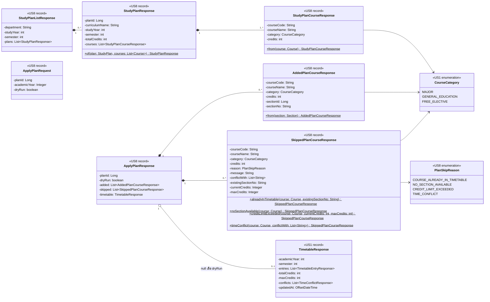

# US8 — DTO Class Diagram

US8 เพิ่ม DTO ใหม่ใน package `studyplan.dto` (`<<US8>>`) สำหรับ 2 endpoint ใน [DTO & API Spec](./US8-DTO-API-Spec.md) และใช้ `TimetableResponse` ของ US1 (`<<US1>>`) ซ้ำเป็นผลหลังยืนยันจัดตาราง

| Type | Endpoint | หน้าที่ |
| --- | --- | --- |
| `StudyPlanListResponse` | `GET /api/study-plans` | ผลการค้นหา preset ตาม `department` ของนักศึกษา + `studyYear` + `semester` ไม่พบได้ `plans: []` |
| `StudyPlanResponse` | 〃 | preset 1 หลักสูตร `totalCredits` คำนวณใน `of()` จากผลรวม `credits` ของ `courses` ไม่ได้เก็บใน DB |
| `StudyPlanCourseResponse` | 〃 | วิชาใน preset เรียงตาม `sortOrder` ยังไม่มีข้อมูล section |
| `ApplyPlanRequest` | `POST /api/timetable/apply-plan` | body · `planId` และ `academicYear` เป็น `@NotNull` (ไม่ส่ง → 400) · `dryRun` เป็น primitive จึงได้ `false` เมื่อไม่ส่ง |
| `ApplyPlanResponse` | 〃 | `timetable` เป็น `null` เมื่อ `dryRun: true` และเป็น `TimetableResponse` ของ US1 เมื่อยืนยัน |
| `AddedPlanCourseResponse` | 〃 | วิชาที่จะเพิ่ม/เพิ่มแล้ว พร้อม section ตัวแทนของกลุ่มเวลาที่ `PlanScheduler` เลือก |
| `SkippedPlanCourseResponse` | 〃 | วิชาที่ข้าม field เสริมมีค่าเฉพาะ `reason` ที่เกี่ยวข้อง ที่เหลือเป็น `null` และไม่ส่งใน JSON |
| `PlanSkipReason` | 〃 | เหตุผลที่ข้าม 2 ค่าแรกได้จากขั้นกรองก่อนค้นหา 2 ค่าหลังได้จากการเทียบกับตารางสุดท้าย (ดู Spec หัวข้อ "วิธีเลือก section") |

| Static method | หน้าที่ |
| --- | --- |
| `StudyPlanResponse.of(plan, courses)` | แปลง entity `StudyPlan` พร้อมวิชาที่เรียงตาม `sortOrder` แล้ว และคำนวณ `totalCredits` |
| `StudyPlanCourseResponse.from(course)` | แปลง entity `Course` ของ US1 |
| `AddedPlanCourseResponse.from(section)` | แปลง `Section` ที่เลือก อ่านข้อมูลวิชาจาก `section.getCourse()` |
| `SkippedPlanCourseResponse.alreadyInTimetable(...)` ฯลฯ | 1 factory ต่อ 1 `reason` สร้าง `message` ภาษาไทยให้ด้วย เช่น `"TU100 อยู่ในตารางแล้ว (Sec 780002)"` ใส่ field เสริมเฉพาะที่ reason นั้นใช้ จึงไม่มีทางสร้าง object ที่ field ไม่ตรงกับ reason |

**รายละเอียดที่ต้องทำให้ตรงกับ Spec:**

- `SkippedPlanCourseResponse` ใส่ `@JsonInclude(JsonInclude.Include.NON_NULL)` ระดับ record เพื่อไม่ส่ง field เสริมที่เป็น `null` ตรงกับ JSON ตัวอย่างและ type `?:` ฝั่ง frontend
- `ApplyPlanResponse` **ไม่**ใส่ `NON_NULL` เพราะ Spec กำหนดให้ส่ง `"timetable": null` ตอน `dryRun`
- `currentCredits` / `maxCredits` ใช้ `Integer` ไม่ใช่ `int` เพื่อให้เป็น `null` ได้ ส่วน `academicYear` ใน request ใช้ `Integer` เพื่อให้ `@NotNull` ตรวจได้ (`int` จะได้ 0 เมื่อไม่ส่ง)
- `GET /api/study-plans` ไม่มี request DTO รับ `studyYear` และ `semester` เป็น `@RequestParam` ตรง ๆ ใน controller พร้อม `@Min` / `@Max` (ดู [API Class Diagram](./US8-API-Class-Diagram.md))
- entity `StudyPlan`, `StudyPlanCourse` ไม่ได้วาด เพราะเป็นงาน ER Diagram ของ US8-T06 ตาม SQL ที่เสนอไว้ใน Spec

ฝั่ง frontend ใช้ type ใน `frontend/features/study-plan/types.ts` ตาม Spec ซึ่งตรงกับ record ด้านบนทีละ field (`StudyPlanList`, `StudyPlan`, `StudyPlanCourse`, `ApplyPlanRequest`, `ApplyPlanResponse`, `AddedPlanCourse`, `SkippedPlanCourse`, `PlanSkipReason`) ส่วน `Timetable` และ `CourseCategory` ใช้ของ US1

สัญลักษณ์: field ของ record เป็น `private final` (-) ส่วน accessor และ constructor ที่ record สร้างให้อัตโนมัติไม่ได้วาด static method (`$`) คือที่ออกแบบเอง ไม่มี `#` เพราะ record สืบทอดไม่ได้ · `*--` = เป็นส่วนหนึ่งของ response · `o--` = อ้างอิง DTO ของ US1 ที่อาจเป็น `null`

## เอกสารที่เกี่ยวข้อง

- [DTO & API Spec](./US8-DTO-API-Spec.md)
- [API Class Diagram](./US8-API-Class-Diagram.md)
- [US1 — DTO Class Diagram](../../US1/T05/US1-DTO-Class-Diagram.md)
