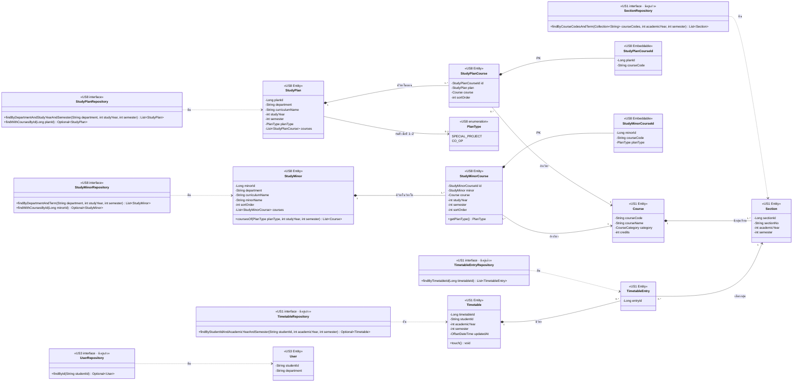

# US8-T06 — DAO Class Diagram

Entity และ repository (DAO) ที่ `StudyPlanService` และ `ApplyPlanService` ใช้ ดู flow การเรียกใช้ใน Sequence Diagram ทั้ง 3 ไฟล์ และโครงสร้างตารางใน [ER Diagram](./US8-T06-ER-Diagram.md)

US8 เพิ่ม entity `StudyPlan`, `StudyPlanCourse`, `StudyPlanCourseId`, `StudyMinor`, `StudyMinorCourse`, `StudyMinorCourseId`, enum `PlanType` และ `StudyPlanRepository`, `StudyMinorRepository` ใน package `studyplan` (`<<US8>>`) ส่วน entity และ repository ของ US1 / US3 ใช้ตามเดิม**ไม่แก้** วาดเฉพาะ method ที่ออกแบบเองหรือที่ US8 เรียกใช้ ไม่วาด method มาตรฐานของ repository เช่น `save` ตามแบบ US1-T06



| Repository | Method | ใช้โดย | ใช้ใน |
| --- | --- | --- | --- |
| `StudyPlanRepository` (ใหม่) | `findByDepartmentAndStudyYearAndSemester` | `StudyPlanService.getPlans` | `GET /api/study-plans` |
| `StudyPlanRepository` (ใหม่) | `findWithCoursesById` | `ApplyPlanService.applyPlan` | `POST /api/timetable/apply-plan` |
| `StudyMinorRepository` (ใหม่) | `findByDepartmentAndTerm` | `StudyPlanService.getPlans` | `GET /api/study-plans` |
| `StudyMinorRepository` (ใหม่) | `findWithCoursesById` | `ApplyPlanService.loadMinor` | `POST /api/timetable/apply-plan` เมื่อส่ง `minorId` |
| `UserRepository` | `findById` (มาตรฐาน) | `StudyPlanService.getPlans` อ่าน `department` | `GET /api/study-plans` |
| `SectionRepository` | `findByCourseCodesAndTerm` | `ApplyPlanService.loadCandidates` | Preview / Confirm |
| `TimetableRepository` | `findByStudentIdAndAcademicYearAndSemester` | `ApplyPlanService.loadCandidates`, `TimetableService.getTimetable` | Preview / Confirm |
| `TimetableRepository` | `save` (มาตรฐาน) | `ApplyPlanService.saveAdded` | Confirm |
| `TimetableEntryRepository` | `findByTimetableId` | `ApplyPlanService.loadCandidates`, `TimetableService.getTimetable` | Preview / Confirm |
| `TimetableEntryRepository` | `saveAll` (มาตรฐาน) | `ApplyPlanService.saveAdded` | Confirm |

## รายละเอียด mapping ของ entity ใหม่

| Entity | Mapping |
| --- | --- |
| `StudyPlan` | `@Table(name = "study_plan")` · `planId` เป็น `@Id @GeneratedValue(IDENTITY)` · `planType` เป็น `@Enumerated(EnumType.STRING)` nullable · `courses` เป็น `@OneToMany(mappedBy = "plan") @OrderBy("sortOrder")` ไม่มี cascade เพราะ preset seed ผ่าน migration |
| `PlanType` | enum ใน package `studyplan` ประกาศตามลำดับ `SPECIAL_PROJECT`, `CO_OP` ซึ่งเป็นลำดับที่ใช้เรียง `plans` (ดูหัวข้อ query) ตัวเดียวกับที่ `StudyPlanResponse.planType` ใช้ใน T05 |
| `StudyPlanCourse` | `@Table(name = "study_plan_course")` · `id` เป็น `@EmbeddedId` · `plan` เป็น `@ManyToOne(fetch = LAZY) @MapsId("planId") @JoinColumn(name = "plan_id")` · `course` เป็น `@ManyToOne(fetch = LAZY) @MapsId("courseCode") @JoinColumn(name = "course_code")` |
| `StudyPlanCourseId` | `@Embeddable` implements `Serializable` มี `equals` / `hashCode` ตาม JPA กำหนดสำหรับ composite key |
| `StudyMinor` | `@Table(name = "study_minor")` · `minorId` เป็น `@Id @GeneratedValue(IDENTITY)` · `courses` เป็น `@OneToMany(mappedBy = "minor") @OrderBy("studyYear, semester, sortOrder")` ไม่มี cascade · `coursesOf(planType, studyYear, semester)` คืน `Course` ของแผนและภาคนั้นตาม `sortOrder` (กรองใน Java จาก `courses` ที่ fetch มาครบแล้ว) |
| `StudyMinorCourse` | `@Table(name = "study_minor_course")` · `@EmbeddedId` + `@MapsId("minorId")` / `@MapsId("courseCode")` แบบเดียวกับ `StudyPlanCourse` · `planType` อยู่ใน id (ตั้งเอง ไม่ผ่าน `@MapsId`) อ่านผ่าน `getPlanType()` · มี `studyYear`, `semester`, `sortOrder` เป็น column ธรรมดา |
| `StudyMinorCourseId` | `@Embeddable` implements `Serializable` (`minorId`, `courseCode`, `planType` เป็น `@Enumerated(EnumType.STRING)`) เพิ่ม `planType` ใน US8-T09 เพราะแผนสหกิจเรียนวิชาโทบางวิชาคนละภาค (ดู ER Diagram) |

- **ใช้ `@EmbeddedId` + `@MapsId`** ทำให้ `plan` / `minor` และ `course` เป็น object ที่ join fetch ได้ ส่วน key แยกเป็น class ชัดเจน ไม่ใช้ `@ManyToMany` เพราะ join table มี `sort_order` (และ `study_year` / `semester` ของวิชาโท) ที่ต้องใช้ และไม่ใช้ `@OrderColumn` เพราะต้องการเลขเริ่ม 0 ที่ต่อเนื่อง ซึ่งไม่ตรงกับ seed
- **`Course` ไม่มี collection ย้อนกลับ** ไปหา `StudyPlanCourse` / `StudyMinorCourse` แบบเดียวกับที่ US1 ไม่ใส่ `sections` ใน `Course` เพราะไม่มี flow ไหนค้นแผนหรือวิชาโทจากวิชา
- **ไม่มี `StudyPlanCourseRepository` / `StudyMinorCourseRepository`** ไม่มี flow ไหนอ่านหรือเขียนวิชาในแผน/วิชาโทแยกจากแผน/วิชาโท
- **`StudyMinor` ไม่มีความสัมพันธ์กับ `StudyPlan`** ตาม ER ความเข้ากันได้ตรวจใน `ApplyPlanService.loadMinor` ด้วย `department` + `curriculumName`
- **เสนอใส่ `@Immutable` (Hibernate)** ที่ entity ใหม่ทั้ง 4 ตัว เพราะแอปไม่มี flow เขียน preset หรือวิชาโท ถ้าโค้ดเผลอแก้ field จะไม่ถูก flush ลง DB (ไม่บังคับ)

## Query ของ `StudyPlanRepository`

ทั้งสอง method เขียน `@Query` เองแบบ `TimetableEntryRepository.findByTimetableId` เพราะต้องโหลดวิชาในแผนมาใน query เดียว (`open-in-view: false` และ `StudyPlanResponse.of` / `loadCandidates` อ่านวิชาทุกตัวหลังจบ query) และต้องเรียงตาม `sortOrder` ให้ชัดเจน

```java
@Query("""
        select p from StudyPlan p
        join fetch p.courses pc
        join fetch pc.course
        where p.department = :department
          and p.studyYear = :studyYear and p.semester = :semester
        order by p.curriculumName, p.planId""")
List<StudyPlan> findByDepartmentAndStudyYearAndSemester(@Param("department") String department,
                                                        @Param("studyYear") int studyYear,
                                                        @Param("semester") int semester);

@Query("""
        select p from StudyPlan p
        join fetch p.courses pc
        join fetch pc.course
        where p.planId = :planId""")
Optional<StudyPlan> findWithCoursesById(@Param("planId") Long planId);
```

- **ลำดับวิชาในแผนมาจาก `@OrderBy("sortOrder")` ของ `StudyPlan.courses`** เมื่อ `join fetch` collection ที่มี `@OrderBy` Hibernate ต่อ `sort_order` ท้าย `order by` ของ SQL ให้เอง (`... order by curriculum_name, plan_id, sort_order`) ห้ามเขียน `pc.sortOrder` ใน JPQL ซ้ำ เพราะ SQL Server ปฏิเสธคอลัมน์ซ้ำใน `order by` (`A column has been specified more than once in the order by list`) ถ้าภายหลังลบ `@OrderBy` ออกจาก entity ต้องเพิ่ม `pc.sortOrder` กลับเข้า JPQL (พบตอนรัน UT-DAO-US8-01 – 18 ใน US8-T09)

- fetch collection เดียว (`courses`) จึงไม่เกิด `MultipleBagFetchException` และ Hibernate 6+ ตัดแถวซ้ำของ `StudyPlan` ให้เอง
- ใช้ `join fetch` (inner join) เพราะ ER กำหนดว่าแผนมีวิชาอย่างน้อย 1 วิชา (`1..*`) แผนที่ไม่มีวิชาจะไม่ถูกคืน ซึ่งถือว่าเป็น seed ผิด
- **query ไม่กรอง `planType`** ปี 3–4 ได้ preset ทั้ง 2 แผนกลับไปพร้อมกันตาม T05 ให้ frontend กรองเอง
- **ลำดับ `plans` (`curriculumName` แล้ว `planType`) เรียงใน `StudyPlanService`** ด้วย `Comparator.comparing(StudyPlan::getCurriculumName).thenComparing(StudyPlan::getPlanType, nullsFirst(naturalOrder()))` ไม่เรียงใน SQL เพราะ `plan_type` เก็บเป็นข้อความ เรียงตามตัวอักษรจะได้ `CO_OP` ก่อน `SPECIAL_PROJECT` ซึ่งไม่ตรง Spec ส่วน `order by ... p.planId` ใน query มีไว้ให้แถวของแต่ละแผนอยู่ติดกันเท่านั้น
- `ApplyPlanService` อ่านเฉพาะรหัสวิชา หมวด และหน่วยกิตจาก `pc.course` จึงไม่ต้อง fetch `Section` ที่นี่ section ของภาคค้นแยกด้วย `findByCourseCodesAndTerm` query เดียว

## Query ของ `StudyMinorRepository`

```java
@Query("""
        select m from StudyMinor m
        join fetch m.courses mc
        join fetch mc.course
        where m.department = :department
          and exists (select 1 from StudyMinorCourse x
                      where x.minor = m and x.studyYear = :studyYear and x.semester = :semester)
        order by m.sortOrder, m.minorId""")
List<StudyMinor> findByDepartmentAndTerm(@Param("department") String department,
                                         @Param("studyYear") int studyYear,
                                         @Param("semester") int semester);

@Query("""
        select m from StudyMinor m
        join fetch m.courses mc
        join fetch mc.course
        where m.minorId = :minorId""")
Optional<StudyMinor> findWithCoursesById(@Param("minorId") Long minorId);
```

- **กรองวิชาโทด้วย `exists` แต่ fetch วิชาครบทุกภาค** แล้วให้ service เรียก `minor.coursesOf(planType, studyYear, semester)` ของแต่ละแผน ส่งเข้า `StudyMinorResponse.of(minor, courses)` ไม่กรอง `mc` ใน `where` ตรง ๆ เพราะจะได้ collection `courses` ที่ไม่ครบอยู่ใน persistence context (Hibernate ไม่รับประกันผลของการกรอง fetch join) วิชาโทหนึ่งมีไม่กี่วิชา การโหลดเกินจึงไม่มีผล
- ผลของ `findByDepartmentAndTerm` จึงมีเฉพาะวิชาโทที่มีวิชาใน `studyYear` + `semester` นั้น**ของแผนใดแผนหนึ่ง** (query ไม่กรอง `plan_type` เพราะปี 3–4 คืน preset ทั้ง 2 แผน) ตาม T05 ปี 1–2 ได้ `[]` เสมอเพราะ `ck_study_minor_course_year`
- query ไม่กรอง `curriculumName` UI แสดงเฉพาะวิชาโทที่ `curriculumName` ตรงกับ preset ที่เลือกตาม Spec
- `findWithCoursesById` ใช้ใน `ApplyPlanService.loadMinor` แล้ว `loadCandidates` เรียก `minor.coursesOf(plan.planType, plan.studyYear, plan.semester)` วิชาโทที่ไม่มีวิชาในภาคของ preset จะไม่เพิ่มวิชาใด (ไม่ใช่ error)
- fetch collection เดียวเช่นเดียวกับ `StudyPlanRepository`
- **ลำดับวิชาในวิชาโทมาจาก `@OrderBy("studyYear, semester, sortOrder")` ของ `StudyMinor.courses`** แบบเดียวกับ `StudyPlanRepository` Hibernate ต่อ `study_year, semester, sort_order` ท้าย `order by` ให้เอง JPQL จึงเรียงแค่ `m.sortOrder, m.minorId`

## เอกสารที่เกี่ยวข้อง

- [Extended API Class Diagram](./US8-T06-Extended-API-Class-Diagram.md)
- [ER Diagram (DB)](./US8-T06-ER-Diagram.md)
- [Sequence Diagram — ดูแผนการเรียน](./US8-T06-Sequence-Diagram-StudyPlans.md)
- [Sequence Diagram — Preview](./US8-T06-Sequence-Diagram-Preview.md)
- [Sequence Diagram — Confirm](./US8-T06-Sequence-Diagram-Confirm.md)
- [API Class Diagram](../T05/US8-API-Class-Diagram.md) (US8-T05)
- [US1-T06 — DAO Class Diagram](../../US1/T06/US1-T06-DAO-Class-Diagram.md)
