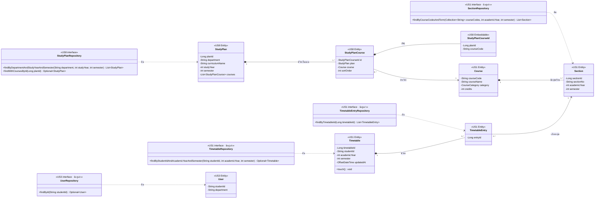

# US8-T06 — DAO Class Diagram

Entity และ repository (DAO) ที่ `StudyPlanService` และ `ApplyPlanService` ใช้ ดู flow การเรียกใช้ใน Sequence Diagram ทั้ง 3 ไฟล์ และโครงสร้างตารางใน [ER Diagram](./US8-T06-ER-Diagram.md)

US8 เพิ่ม entity `StudyPlan`, `StudyPlanCourse`, `StudyPlanCourseId` และ `StudyPlanRepository` ใน package `studyplan` (`<<US8>>`) ส่วน entity และ repository ของ US1 / US3 ใช้ตามเดิม**ไม่แก้** วาดเฉพาะ method ที่ออกแบบเองหรือที่ US8 เรียกใช้ ไม่วาด method มาตรฐานของ repository เช่น `save` ตามแบบ US1-T06



| Repository | Method | ใช้โดย | ใช้ใน |
| --- | --- | --- | --- |
| `StudyPlanRepository` (ใหม่) | `findByDepartmentAndStudyYearAndSemester` | `StudyPlanService.getPlans` | `GET /api/study-plans` |
| `StudyPlanRepository` (ใหม่) | `findWithCoursesById` | `ApplyPlanService.applyPlan` | `POST /api/timetable/apply-plan` |
| `UserRepository` | `findById` (มาตรฐาน) | `StudyPlanService.getPlans` อ่าน `department` | `GET /api/study-plans` |
| `SectionRepository` | `findByCourseCodesAndTerm` | `ApplyPlanService.loadCandidates` | Preview / Confirm |
| `TimetableRepository` | `findByStudentIdAndAcademicYearAndSemester` | `ApplyPlanService.loadCandidates`, `TimetableService.getTimetable` | Preview / Confirm |
| `TimetableRepository` | `save` (มาตรฐาน) | `ApplyPlanService.saveAdded` | Confirm |
| `TimetableEntryRepository` | `findByTimetableId` | `ApplyPlanService.loadCandidates`, `TimetableService.getTimetable` | Preview / Confirm |
| `TimetableEntryRepository` | `saveAll` (มาตรฐาน) | `ApplyPlanService.saveAdded` | Confirm |

## รายละเอียด mapping ของ entity ใหม่

| Entity | Mapping |
| --- | --- |
| `StudyPlan` | `@Table(name = "study_plan")` · `planId` เป็น `@Id @GeneratedValue(IDENTITY)` · `courses` เป็น `@OneToMany(mappedBy = "plan") @OrderBy("sortOrder")` ไม่มี cascade เพราะ preset seed ผ่าน migration |
| `StudyPlanCourse` | `@Table(name = "study_plan_course")` · `id` เป็น `@EmbeddedId` · `plan` เป็น `@ManyToOne(fetch = LAZY) @MapsId("planId") @JoinColumn(name = "plan_id")` · `course` เป็น `@ManyToOne(fetch = LAZY) @MapsId("courseCode") @JoinColumn(name = "course_code")` |
| `StudyPlanCourseId` | `@Embeddable` implements `Serializable` มี `equals` / `hashCode` ตาม JPA กำหนดสำหรับ composite key |

- **ใช้ `@EmbeddedId` + `@MapsId`** ทำให้ `plan` และ `course` เป็น object ที่ join fetch ได้ ส่วน key แยกเป็น class ชัดเจน ไม่ใช้ `@ManyToMany` เพราะ join table มี `sort_order` ที่ต้องใช้เรียงลำดับ และไม่ใช้ `@OrderColumn` เพราะต้องการเลขเริ่ม 0 ที่ต่อเนื่อง ซึ่งไม่ตรงกับ seed
- **`Course` ไม่มี collection ย้อนกลับ** ไปหา `StudyPlanCourse` แบบเดียวกับที่ US1 ไม่ใส่ `sections` ใน `Course` เพราะไม่มี flow ไหนค้นแผนจากวิชา
- **ไม่มี `StudyPlanCourseRepository`** ไม่มี flow ไหนอ่านหรือเขียนวิชาในแผนแยกจากแผน
- **เสนอใส่ `@Immutable` (Hibernate)** ที่ `StudyPlan` และ `StudyPlanCourse` เพราะแอปไม่มี flow เขียน preset ถ้าโค้ดเผลอแก้ field จะไม่ถูก flush ลง DB (ไม่บังคับ)

## Query ของ `StudyPlanRepository`

ทั้งสอง method เขียน `@Query` เองแบบ `TimetableEntryRepository.findByTimetableId` เพราะต้องโหลดวิชาในแผนมาใน query เดียว (`open-in-view: false` และ `StudyPlanResponse.of` / `loadCandidates` อ่านวิชาทุกตัวหลังจบ query) และต้องเรียงตาม `sortOrder` ให้ชัดเจน

```java
@Query("""
        select p from StudyPlan p
        join fetch p.courses pc
        join fetch pc.course
        where p.department = :department
          and p.studyYear = :studyYear and p.semester = :semester
        order by p.curriculumName, pc.sortOrder""")
List<StudyPlan> findByDepartmentAndStudyYearAndSemester(@Param("department") String department,
                                                        @Param("studyYear") int studyYear,
                                                        @Param("semester") int semester);

@Query("""
        select p from StudyPlan p
        join fetch p.courses pc
        join fetch pc.course
        where p.planId = :planId
        order by pc.sortOrder""")
Optional<StudyPlan> findWithCoursesById(@Param("planId") Long planId);
```

- fetch collection เดียว (`courses`) จึงไม่เกิด `MultipleBagFetchException` และ Hibernate 6+ ตัดแถวซ้ำของ `StudyPlan` ให้เอง
- ใช้ `join fetch` (inner join) เพราะ ER กำหนดว่าแผนมีวิชาอย่างน้อย 1 วิชา (`1..*`) แผนที่ไม่มีวิชาจะไม่ถูกคืน ซึ่งถือว่าเป็น seed ผิด
- เรียงแผนตาม `curriculumName` เพื่อให้ `plans` ใน `StudyPlanListResponse` มีลำดับคงที่ เมื่อสาขาเดียวกันมีมากกว่า 1 หลักสูตร
- `ApplyPlanService` อ่านเฉพาะรหัสวิชา หมวด และหน่วยกิตจาก `pc.course` จึงไม่ต้อง fetch `Section` ที่นี่ section ของภาคค้นแยกด้วย `findByCourseCodesAndTerm` query เดียว

## เอกสารที่เกี่ยวข้อง

- [Extended API Class Diagram](./US8-T06-Extended-API-Class-Diagram.md)
- [ER Diagram (DB)](./US8-T06-ER-Diagram.md)
- [Sequence Diagram — ดูแผนการเรียน](./US8-T06-Sequence-Diagram-StudyPlans.md)
- [Sequence Diagram — Preview](./US8-T06-Sequence-Diagram-Preview.md)
- [Sequence Diagram — Confirm](./US8-T06-Sequence-Diagram-Confirm.md)
- [API Class Diagram](../T05/US8-API-Class-Diagram.md) (US8-T05)
- [US1-T06 — DAO Class Diagram](../../US1/T06/US1-T06-DAO-Class-Diagram.md)
