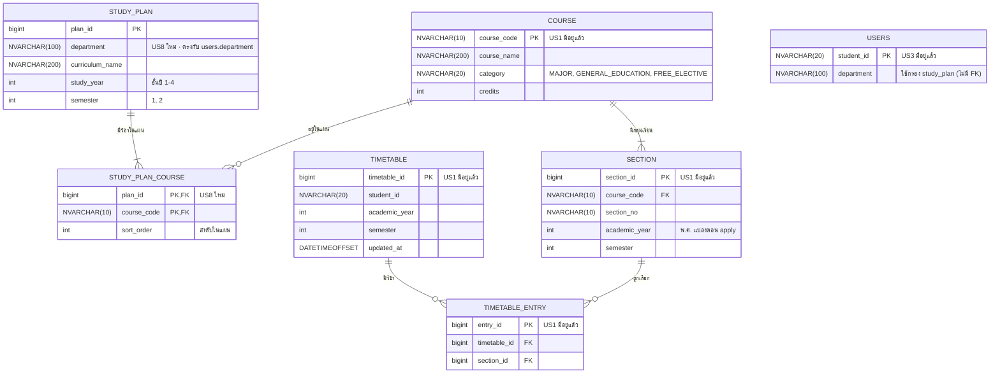

# US8-T06 — ER Diagram (DB)

โครงสร้างฐานข้อมูลของแผนการเรียน (preset) ที่ US8 เพิ่ม 2 ตาราง คือ `study_plan` และ `study_plan_course` และตารางเดิมของ US1 / US3 ที่เกี่ยวข้อง ต่อจาก SQL ที่เสนอไว้ใน [DTO & API Spec](../T05/US8-DTO-API-Spec.md) (US8-T05)

**preset ผูกกับหลักสูตร + ชั้นปี + ภาคเรียน ไม่ผูกกับปีการศึกษา (พ.ศ.)** preset เดียวใช้ได้ทุกปี ตอน apply ค่อยแปลงรหัสวิชาเป็น section ของ `academic_year` ที่ขอมา



ข้อกำหนดของตาราง

| ตาราง | Constraint | เหตุผล |
| --- | --- | --- |
| `study_plan` | unique (`department`, `curriculum_name`, `study_year`, `semester`) | 1 หลักสูตรมี 1 แผนต่อชั้นปีต่อภาคเรียน |
| `study_plan` | CHECK `semester IN (1, 2)` | ไม่มีภาคฤดูร้อนตามขอบเขตของ Spec |
| `study_plan` | CHECK `study_year BETWEEN 1 AND 4` | ตรงกับช่วงที่ `GET /api/study-plans` รับ (เพิ่มจาก SQL ใน T05) |
| `study_plan_course` | PK (`plan_id`, `course_code`) | กันวิชาซ้ำในแผนเดียวกัน |
| `study_plan_course` | FK `plan_id` → `study_plan` `ON DELETE CASCADE` | ลบแผนแล้ววิชาในแผนหายไปด้วย |
| `study_plan_course` | FK `course_code` → `course` | รหัสวิชาใน preset ต้องมีอยู่จริง |
| `study_plan_course` | unique (`plan_id`, `sort_order`) | ลำดับในแผนไม่ซ้ำ ผล tie-break ของ `PlanScheduler` จึงคาดเดาได้ (เพิ่มจาก SQL ใน T05) |

- **ไม่มี `academic_year` ใน preset** ตอน apply `ApplyPlanService` ใช้ `course_code` ทั้งหมดของแผนค้น `section` ด้วย `academic_year` จาก request และ `semester` ของแผน (`SectionRepository.findByCourseCodesAndTerm`) วิชาที่ภาคนั้นไม่มี section จะได้ `NO_SECTION_AVAILABLE`
- **อ้าง `course_code` ไม่ใช่ `section_id`** เพราะ section เปลี่ยนทุกภาค `STUDY_PLAN_COURSE` จึงเชื่อมกับ `SECTION` ผ่าน `COURSE` ไม่มี FK ตรง
- **ไม่เก็บ `category` และ `credits` ซ้ำ** อ่านจาก `course` ส่วน `totalCredits` ของแผนคำนวณใน `StudyPlanResponse.of` ไม่ได้เก็บใน DB
- **`department` เป็นข้อความ ไม่มี FK** เพราะ `users.department` ของ US3 เป็น `NVARCHAR(100)` ธรรมดาจาก TU API ไม่มีตารางสาขา ค่าใน seed ต้องสะกดตรงกับที่ TU API ส่งมา ไม่เช่นนั้นจะได้ `plans: []`
- **ไม่แยกตาราง `curriculum`** `curriculum_name` ซ้ำในแถวของหลักสูตรเดียวกัน (สูงสุด 4 ชั้นปี × 2 ภาค = 8 แถว) แต่ข้อมูลเป็น seed ที่ไม่มีหน้าแก้ไข และ API ไม่เคยค้นหลักสูตรโดยไม่ระบุชั้นปี จึงเก็บเป็น column ตาม T05 เพื่อไม่ต้องแก้ DTO และ API Class Diagram
- **ไม่ผูกกับ `timetable`** ตอนยืนยัน วิชาในแผนถูกบันทึกเป็น `timetable_entry` ปกติ ไม่เก็บ `plan_id` ไว้ ตารางจึงเพิ่มหรือลบวิชาต่อผ่าน US1 / US2 ได้ตามเดิม และไม่ต้องแก้ schema ของ US1
- **วิชาเลือกที่แผนไม่ได้ระบุรหัสไม่อยู่ใน preset** นักศึกษาเพิ่มเองผ่าน US1 preset seed ผ่าน Flyway migration ไม่มีหน้าสร้าง/แก้

### SQL (สำหรับ migration)

SQL ชุดนี้เป็นฉบับที่ใช้สร้าง Flyway migration แทนข้อเสนอในหัวข้อ "ข้อมูล preset" ของ US8-T05 ต่างจากข้อเสนอเดิม 2 ข้อ คือเพิ่ม `ck_study_plan_study_year` และ `uq_study_plan_course_order`

```sql
CREATE TABLE study_plan (
    plan_id         BIGINT IDENTITY(1,1) NOT NULL,
    department      NVARCHAR(100) NOT NULL,   -- ตรงกับ users.department
    curriculum_name NVARCHAR(200) NOT NULL,
    study_year      INT           NOT NULL,   -- ชั้นปีที่ 1–4
    semester        INT           NOT NULL,
    CONSTRAINT pk_study_plan PRIMARY KEY (plan_id),
    CONSTRAINT uq_study_plan UNIQUE (department, curriculum_name, study_year, semester),
    CONSTRAINT ck_study_plan_study_year CHECK (study_year BETWEEN 1 AND 4),
    CONSTRAINT ck_study_plan_semester CHECK (semester IN (1, 2))
);

CREATE TABLE study_plan_course (
    plan_id     BIGINT       NOT NULL,
    course_code NVARCHAR(10) NOT NULL,
    sort_order  INT          NOT NULL,
    CONSTRAINT pk_study_plan_course PRIMARY KEY (plan_id, course_code),
    CONSTRAINT uq_study_plan_course_order UNIQUE (plan_id, sort_order),
    CONSTRAINT fk_study_plan_course_plan FOREIGN KEY (plan_id) REFERENCES study_plan (plan_id) ON DELETE CASCADE,
    CONSTRAINT fk_study_plan_course_course FOREIGN KEY (course_code) REFERENCES course (course_code)
);
```

unique constraint `uq_study_plan` ช่วย query `findByDepartmentAndStudyYearAndSemester` ได้ เพราะ `department` เป็น column แรก จึง seek ด้วย `department` แล้วกรอง `study_year` / `semester` ต่อ ข้อมูล preset มีไม่กี่สิบแถวจึงไม่ต้องเพิ่ม index แยก

## เอกสารที่เกี่ยวข้อง

- [Extended API Class Diagram](./US8-T06-Extended-API-Class-Diagram.md)
- [DAO Class Diagram](./US8-T06-DAO-Class-Diagram.md)
- [Sequence Diagram — ดูแผนการเรียน](./US8-T06-Sequence-Diagram-StudyPlans.md)
- [Sequence Diagram — Preview](./US8-T06-Sequence-Diagram-Preview.md)
- [Sequence Diagram — Confirm](./US8-T06-Sequence-Diagram-Confirm.md)
- [DTO & API Spec](../T05/US8-DTO-API-Spec.md) (US8-T05)
- [US1-T06 — ER Diagram](../../US1/T06/US1-T06-ER-Diagram.md)
