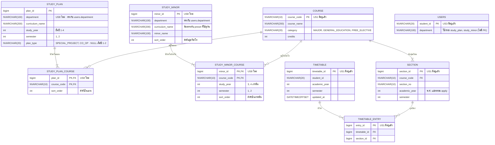

# US8-T06 — ER Diagram (DB)

โครงสร้างฐานข้อมูลของแผนการเรียน (preset) และวิชาโทที่ US8 เพิ่ม 4 ตาราง คือ `study_plan`, `study_plan_course`, `study_minor` และ `study_minor_course` และตารางเดิมของ US1 / US3 ที่เกี่ยวข้อง ต่อจาก SQL ที่เสนอไว้ใน [DTO & API Spec](../T05/US8-DTO-API-Spec.md) (US8-T05)

**preset ผูกกับหลักสูตร + ชั้นปี + ภาคเรียน (+ แผนของปี 3–4) ไม่ผูกกับปีการศึกษา (พ.ศ.)** preset เดียวใช้ได้ทุกปี ตอน apply ค่อยแปลงรหัสวิชาเป็น section ของ `academic_year` ที่ขอมา วิชาโทก็เช่นเดียวกัน



ข้อกำหนดของตาราง

| ตาราง | Constraint | เหตุผล |
| --- | --- | --- |
| `study_plan` | unique (`department`, `curriculum_name`, `study_year`, `semester`, `plan_type`) | 1 หลักสูตรมี 1 แผนต่อชั้นปีต่อภาคเรียน (ปี 3–4 มี 1 แผนต่อ `plan_type`) |
| `study_plan` | CHECK `semester IN (1, 2)` | ไม่มีภาคฤดูร้อนตามขอบเขตของ Spec |
| `study_plan` | CHECK `ck_study_plan_plan_type` | ปี 1–2 ต้องไม่มีแผน (`plan_type IS NULL`) ปี 3–4 ต้องเป็น `SPECIAL_PROJECT` หรือ `CO_OP` เท่านั้น จึงบังคับช่วง `study_year` 1–4 ไปด้วย |
| `study_plan_course` | PK (`plan_id`, `course_code`) | กันวิชาซ้ำในแผนเดียวกัน |
| `study_plan_course` | FK `plan_id` → `study_plan` `ON DELETE CASCADE` | ลบแผนแล้ววิชาในแผนหายไปด้วย |
| `study_plan_course` | FK `course_code` → `course` | รหัสวิชาใน preset ต้องมีอยู่จริง |
| `study_plan_course` | unique (`plan_id`, `sort_order`) | ลำดับในแผนไม่ซ้ำ ผล tie-break ของ `PlanScheduler` จึงคาดเดาได้ (เพิ่มจาก SQL ใน T05) |
| `study_minor` | unique (`department`, `curriculum_name`, `minor_name`) | ชื่อวิชาโทไม่ซ้ำในหลักสูตรเดียวกัน |
| `study_minor` | unique (`department`, `curriculum_name`, `sort_order`) | ลำดับปุ่มวิชาโทคงที่ (เพิ่มจาก SQL ใน T05) |
| `study_minor_course` | PK (`minor_id`, `course_code`) | 1 วิชาอยู่ในวิชาโทเดียวกันได้ครั้งเดียว (อยู่ได้ภาคเดียว) |
| `study_minor_course` | FK `minor_id` → `study_minor` `ON DELETE CASCADE` | ลบวิชาโทแล้ววิชาในวิชาโทหายไปด้วย |
| `study_minor_course` | FK `course_code` → `course` | รหัสวิชาต้องมีอยู่จริง |
| `study_minor_course` | CHECK `semester IN (1, 2)`, CHECK `study_year IN (3, 4)` | วิชาโทเลือกได้เฉพาะปี 3–4 ปี 1–2 จึงได้ `minors: []` เสมอ |
| `study_minor_course` | unique (`minor_id`, `study_year`, `semester`, `sort_order`) | ลำดับในภาคไม่ซ้ำ ผล tie-break คาดเดาได้แบบ `study_plan_course` (เพิ่มจาก SQL ใน T05) |

- **ไม่มี `academic_year` ใน preset และวิชาโท** ตอน apply `ApplyPlanService` รวม `course_code` ของแผนกับวิชาโท (เฉพาะ `study_year` + `semester` ของแผน) แล้วค้น `section` ด้วย `academic_year` จาก request และ `semester` ของแผน (`SectionRepository.findByCourseCodesAndTerm`) ครั้งเดียว วิชาที่ภาคนั้นไม่มี section จะได้ `NO_SECTION_AVAILABLE`
- **อ้าง `course_code` ไม่ใช่ `section_id`** เพราะ section เปลี่ยนทุกภาค `STUDY_PLAN_COURSE` และ `STUDY_MINOR_COURSE` จึงเชื่อมกับ `SECTION` ผ่าน `COURSE` ไม่มี FK ตรง
- **ไม่เก็บ `category` และ `credits` ซ้ำ** อ่านจาก `course` ส่วน `totalCredits` ของแผนและวิชาโทคำนวณใน `StudyPlanResponse.of` / `StudyMinorResponse.of` ไม่ได้เก็บใน DB
- **`plan_type` เป็น `NULL` ได้** ปี 1–2 มีแผนเดียว `uq_study_plan` ของ SQL Server นับ `NULL` เป็นค่าเดียวกัน ปี 1–2 จึงมีได้ 1 preset ต่อหลักสูตร/ภาคตามเดิม ภาคที่ทั้ง 2 แผนเรียนวิชาเหมือนกันยัง seed เป็น 2 แถวแยกกันตาม Spec ชื่อ column ไม่ใช้ `track` เพราะซ้ำกับ `users.track` (ภาคปกติ/พิเศษ) ของ US3
- **วิชาโทแยกจาก `study_plan`** เพราะเลือกได้อิสระจากแผน (หัวข้อพิเศษ/สหกิจ) และรายวิชากระจายหลายชั้นปี/ภาค จึงเก็บ 1 แถวต่อ 1 วิชาโทที่ `study_minor` และแยกชั้นปี/ภาคไว้ที่ `study_minor_course` ไม่มี FK ไปหา `study_plan` ความสัมพันธ์กับ preset ตรวจตอน apply ด้วย `department` + `curriculum_name` (ไม่ตรง → 400 `MINOR_PLAN_MISMATCH`)
- **`department` เป็นข้อความ ไม่มี FK** เพราะ `users.department` ของ US3 เป็น `NVARCHAR(100)` ธรรมดาจาก TU API ไม่มีตารางสาขา ค่าใน seed ต้องสะกดตรงกับที่ TU API ส่งมา ไม่เช่นนั้นจะได้ `plans: []` / `minors: []`
- **ไม่แยกตาราง `curriculum`** `curriculum_name` ซ้ำในแถวของหลักสูตรเดียวกัน (สูงสุด 2 + 2 + 4 + 4 = 12 แถวใน `study_plan` ต่อหลักสูตร และอีกไม่กี่แถวใน `study_minor`) แต่ข้อมูลเป็น seed ที่ไม่มีหน้าแก้ไข และ API ไม่เคยค้นหลักสูตรโดยไม่ระบุชั้นปี จึงเก็บเป็น column ตาม T05 เพื่อไม่ต้องแก้ DTO และ API Class Diagram
- **ไม่ผูกกับ `timetable`** ตอนยืนยัน วิชาในแผนและวิชาโทถูกบันทึกเป็น `timetable_entry` ปกติ ไม่เก็บ `plan_id`, `minor_id` หรือ `source` ไว้ ตารางจึงเพิ่มหรือลบวิชาต่อผ่าน US1 / US2 ได้ตามเดิม และไม่ต้องแก้ schema ของ US1 ส่วนแผนและวิชาโทที่เลือกก็ไม่ได้บันทึกตาม Spec
- **วิชาเลือกที่แผนไม่ได้ระบุรหัสไม่อยู่ใน preset** นักศึกษาเพิ่มเองผ่าน US1 preset และวิชาโท seed ผ่าน Flyway migration ไม่มีหน้าสร้าง/แก้

### SQL (สำหรับ migration)

SQL ชุดนี้เป็นฉบับที่ใช้สร้าง Flyway migration แทนข้อเสนอในหัวข้อ "ข้อมูล preset" ของ US8-T05 ต่างจากข้อเสนอเดิม 3 ข้อ คือเพิ่ม `uq_study_plan_course_order`, `uq_study_minor_order` และ `uq_study_minor_course_order` (ช่วง `study_year` 1–4 ของ `study_plan` บังคับผ่าน `ck_study_plan_plan_type` แล้ว จึงไม่ต้องมี CHECK แยก)

```sql
CREATE TABLE study_plan (
    plan_id         BIGINT IDENTITY(1,1) NOT NULL,
    department      NVARCHAR(100) NOT NULL,   -- ตรงกับ users.department
    curriculum_name NVARCHAR(200) NOT NULL,
    study_year      INT           NOT NULL,   -- ชั้นปีที่ 1–4
    semester        INT           NOT NULL,
    plan_type       NVARCHAR(20)  NULL,       -- SPECIAL_PROJECT / CO_OP เฉพาะชั้นปีที่ 3–4
    CONSTRAINT pk_study_plan PRIMARY KEY (plan_id),
    CONSTRAINT uq_study_plan UNIQUE (department, curriculum_name, study_year, semester, plan_type),
    CONSTRAINT ck_study_plan_semester CHECK (semester IN (1, 2)),
    CONSTRAINT ck_study_plan_plan_type CHECK (
        (study_year IN (1, 2) AND plan_type IS NULL)
        OR (study_year IN (3, 4) AND plan_type IN ('SPECIAL_PROJECT', 'CO_OP'))
    )
);

CREATE TABLE study_plan_course (
    plan_id     BIGINT       NOT NULL,
    course_code NVARCHAR(10) NOT NULL,
    sort_order  INT          NOT NULL,
    CONSTRAINT pk_study_plan_course PRIMARY KEY (plan_id, course_code),
    CONSTRAINT uq_study_plan_course_order UNIQUE (plan_id, sort_order),
    CONSTRAINT fk_study_plan_course_plan FOREIGN KEY (plan_id) REFERENCES study_plan (plan_id) ON DELETE CASCADE,
    CONSTRAINT fk_study_plan_course_course FOREIGN KEY (course_code) REFERENCES course (course_code)
);

CREATE TABLE study_minor (
    minor_id        BIGINT IDENTITY(1,1) NOT NULL,
    department      NVARCHAR(100) NOT NULL,   -- ตรงกับ users.department
    curriculum_name NVARCHAR(200) NOT NULL,   -- ตรงกับ study_plan.curriculum_name
    minor_name      NVARCHAR(100) NOT NULL,   -- เช่น วิทยาการข้อมูล, ปัญญาประดิษฐ์
    sort_order      INT           NOT NULL,
    CONSTRAINT pk_study_minor PRIMARY KEY (minor_id),
    CONSTRAINT uq_study_minor UNIQUE (department, curriculum_name, minor_name),
    CONSTRAINT uq_study_minor_order UNIQUE (department, curriculum_name, sort_order)
);

CREATE TABLE study_minor_course (
    minor_id    BIGINT       NOT NULL,
    course_code NVARCHAR(10) NOT NULL,
    study_year  INT          NOT NULL,        -- วิชาโทแนะนำให้เรียนชั้นปี/ภาคไหน (3–4 เท่านั้น)
    semester    INT          NOT NULL,
    sort_order  INT          NOT NULL,
    CONSTRAINT pk_study_minor_course PRIMARY KEY (minor_id, course_code),
    CONSTRAINT uq_study_minor_course_order UNIQUE (minor_id, study_year, semester, sort_order),
    CONSTRAINT fk_study_minor_course_minor FOREIGN KEY (minor_id) REFERENCES study_minor (minor_id) ON DELETE CASCADE,
    CONSTRAINT fk_study_minor_course_course FOREIGN KEY (course_code) REFERENCES course (course_code),
    CONSTRAINT ck_study_minor_course_semester CHECK (semester IN (1, 2)),
    CONSTRAINT ck_study_minor_course_year CHECK (study_year IN (3, 4))
);
```

- `uq_study_plan` ช่วย query `findByDepartmentAndStudyYearAndSemester` ได้ เพราะ `department` เป็น column แรก จึง seek ด้วย `department` แล้วกรอง `study_year` / `semester` ต่อ ส่วน `uq_study_minor` ช่วย `findByDepartmentAndTerm` แบบเดียวกัน ข้อมูลมีไม่กี่สิบแถวจึงไม่ต้องเพิ่ม index แยก
- `study_minor_course` ไม่มี `plan_type` วิชาโทใช้ได้ทั้งแผนหัวข้อพิเศษและแผนสหกิจ
- entity เก็บ `plan_type` เป็น `@Enumerated(EnumType.STRING)` ค่าใน DB จึงตรงกับชื่อ enum `PlanType` (ดู [DAO Class Diagram](./US8-T06-DAO-Class-Diagram.md))

## เอกสารที่เกี่ยวข้อง

- [Extended API Class Diagram](./US8-T06-Extended-API-Class-Diagram.md)
- [DAO Class Diagram](./US8-T06-DAO-Class-Diagram.md)
- [Sequence Diagram — ดูแผนการเรียน](./US8-T06-Sequence-Diagram-StudyPlans.md)
- [Sequence Diagram — Preview](./US8-T06-Sequence-Diagram-Preview.md)
- [Sequence Diagram — Confirm](./US8-T06-Sequence-Diagram-Confirm.md)
- [DTO & API Spec](../T05/US8-DTO-API-Spec.md) (US8-T05)
- [US1-T06 — ER Diagram](../../US1/T06/US1-T06-ER-Diagram.md)
