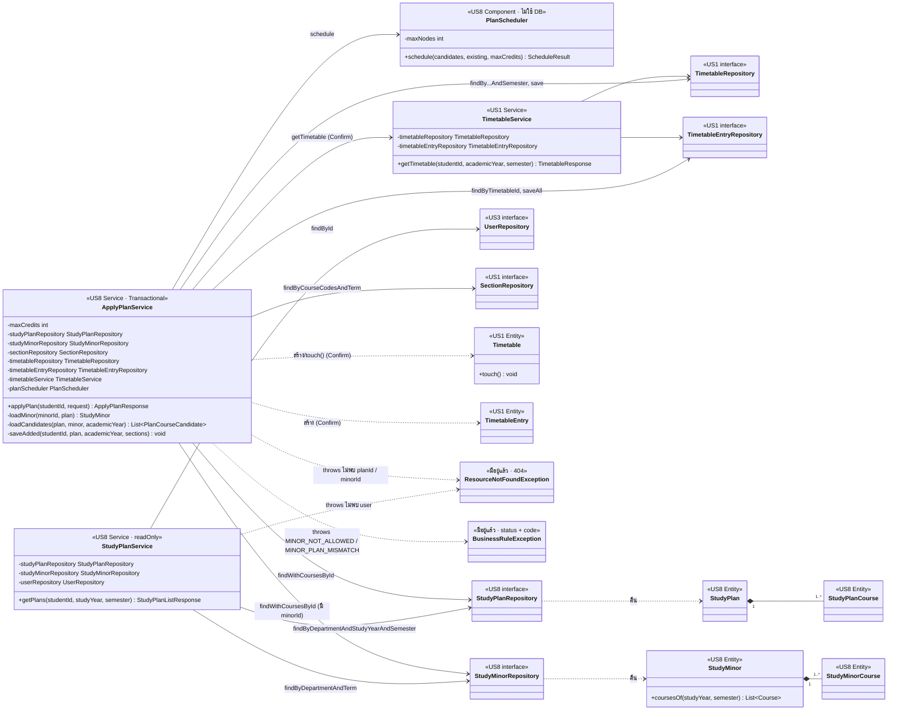

# US8-T06 — Extended API Class Diagram

ขยายจาก [API Class Diagram](../T05/US8-API-Class-Diagram.md) ของ US8-T05 โดยต่อ service เข้ากับ repository และ entity ใน [DAO Class Diagram](./US8-T06-DAO-Class-Diagram.md) พร้อมระบุ transaction และ method ของ repository ที่แต่ละ method ของ service เรียก ส่วน controller, `CurrentStudentProvider`, `GlobalExceptionHandler`, DTO และโมดูลฝั่ง frontend ไม่เปลี่ยนจาก T05 จึงไม่วาดซ้ำ

| Service method | เรียก repository / class | ใช้ใน |
| --- | --- | --- |
| `StudyPlanService.getPlans` | `userRepository.findById` → `studyPlanRepository.findByDepartmentAndStudyYearAndSemester` → เรียง `curriculumName` แล้ว `planType` → `StudyPlanResponse.of` → `studyMinorRepository.findByDepartmentAndTerm` → `StudyMinorResponse.of(minor, minor.coursesOf(studyYear, semester))` | `GET /api/study-plans` |
| `ApplyPlanService.applyPlan` | `studyPlanRepository.findWithCoursesById` → (`minorId` ไม่ใช่ `null`) `loadMinor` → `loadCandidates` → `planScheduler.schedule` → (`dryRun: false`) `saveAdded` → `timetableService.getTimetable` | Preview / Confirm |
| `ApplyPlanService.loadMinor` | `plan.studyYear` 1–2 → `BusinessRuleException(400, "MINOR_NOT_ALLOWED")` → `studyMinorRepository.findWithCoursesById` (ไม่พบ → `ResourceNotFoundException`) → `department` / `curriculumName` ไม่ตรงกับ preset → `BusinessRuleException(400, "MINOR_PLAN_MISMATCH")` | Preview / Confirm เมื่อส่ง `minorId` |
| `ApplyPlanService.loadCandidates` | รวมวิชาของแผน (`PLAN`) กับ `minor.coursesOf(plan.studyYear, plan.semester)` (`MINOR`, ตัดรหัสที่ซ้ำกับแผน) → `timetableRepository.findByStudentIdAndAcademicYearAndSemester` → `timetableEntryRepository.findByTimetableId` (ถ้ามีตาราง) → `sectionRepository.findByCourseCodesAndTerm` | Preview / Confirm |
| `ApplyPlanService.saveAdded` | `new Timetable` (ถ้ายังไม่มี) → `timetable.touch()` → `timetableRepository.save` → `timetableEntryRepository.saveAll` | Confirm เมื่อ `added` ไม่ว่าง |

- **field ตรงกับ T05 ฉบับปรับปรุง** T05 เพิ่ม `studyMinorRepository` ให้ทั้งสอง service และ `loadMinor` / พารามิเตอร์ `minor` ของ `loadCandidates` แล้ว เอกสารนี้ต่อเส้นไปถึง entity และระบุ method ของ repository ที่เรียก ส่วน signature ของ method ใน repository อยู่ใน [DAO Class Diagram](./US8-T06-DAO-Class-Diagram.md)
- **`StudyPlanService` เป็น `@Transactional(readOnly = true)`** ไม่มีการเขียน และ `StudyPlanResponse.of` / `StudyMinorResponse.of` อ่านวิชาที่ fetch มาแล้วใน query ของแต่ละ repository (รวม 3 query ต่อ request ไม่ขึ้นกับจำนวนแผน/วิชาโท)
- **`ApplyPlanService` เป็น `@Transactional`** ที่ระดับ class ทั้ง Preview และ Confirm อยู่ใน transaction เดียวกับ `getTimetable` Preview ไม่เรียก `saveAdded` จึงไม่มีการเขียน ส่วน Confirm บันทึกแบบ all-or-nothing และ Hibernate flush ก่อน query ใน `getTimetable`
- **`loadMinor` ตรวจก่อนอ่าน entry และ section** `MINOR_NOT_ALLOWED` ตรวจจาก `plan.studyYear` ก่อนหาวิชาโท (ไม่ query `study_minor` เลย) และทุก error ของ `loadMinor` เกิดก่อนเขียน DB จึงไม่มีการเขียนแม้เป็น Confirm ตามเทสต์ที่ T05 เสนอ
- **`PlanCourseCandidate.source`** `loadCandidates` ตั้ง `PLAN` / `MINOR` ให้แต่ละวิชา วิชาที่อยู่ทั้งในแผนและวิชาโทเป็น `PLAN` ตัวเดียว `PlanScheduler` ใช้ `source` ในเกณฑ์ "ดีที่สุด" แล้วส่งต่อไปที่ `AddedPlanCourseResponse.from(section, source)` / factory ของ `SkippedPlanCourseResponse`
- **`saveAdded` เขียนผ่าน repository โดยตรง** ไม่เรียก `TimetableService.addEntry` ของ US1 เพราะ `addEntry` ทำงานทีละ section, query ซ้ำ และไม่ตรวจเวลาชน (ดูหมายเหตุใน [Sequence Diagram — Confirm](./US8-T06-Sequence-Diagram-Confirm.md)) วิชา `PLAN` และ `MINOR` บันทึกเป็น `TimetableEntry` แบบเดียวกัน ไม่เก็บ `source`
- **`PlanScheduler` ไม่มี repository เป็น field** รับข้อมูลที่ `loadCandidates` เตรียมไว้ จึง unit test ได้โดยไม่มี DB · `maxNodes` อ่านจาก `app.study-plan.max-search-nodes` (default `50000`)
- **`maxCredits`** ของ `ApplyPlanService` อ่านจาก `app.timetable.max-credits` (22) ค่าเดียวกับ `TimetableService` ส่วน `ApplyPlanService` และ `PlanScheduler` เขียน constructor เองเพราะมีค่าจาก `@Value` แบบ `TimetableService` service อื่นใช้ `@RequiredArgsConstructor`
- **`TimetableService`** วาดเฉพาะส่วนที่ US8 ใช้ ส่วน `sectionRepository`, `maxCredits`, `addEntry` และ private method ดูได้ใน [Extended API Class Diagram ของ US1-T06](../../US1/T06/US1-T06-Extended-API-Class-Diagram.md) การย้ายสูตรเวลาชนไป `ScheduleOverlap` เป็น PR refactor แยกตาม T05
- **ไม่มี exception class ใหม่** 404 ใช้ `ResourceNotFoundException` เดิม `MINOR_NOT_ALLOWED` / `MINOR_PLAN_MISMATCH` เป็น `code` ใหม่ที่ส่งผ่าน `BusinessRuleException` เดิม 400 จาก validation มาจาก Spring ทั้งหมดแปลงเป็น ProblemDetail โดย `GlobalExceptionHandler` เดิม (`handleBusinessRule` ใส่ `code` ลง ProblemDetail ให้แล้ว)

## เอกสารที่เกี่ยวข้อง

- [DAO Class Diagram](./US8-T06-DAO-Class-Diagram.md)
- [ER Diagram (DB)](./US8-T06-ER-Diagram.md)
- [Sequence Diagram — ดูแผนการเรียน](./US8-T06-Sequence-Diagram-StudyPlans.md)
- [Sequence Diagram — Preview](./US8-T06-Sequence-Diagram-Preview.md)
- [Sequence Diagram — Confirm](./US8-T06-Sequence-Diagram-Confirm.md)
- [API Class Diagram](../T05/US8-API-Class-Diagram.md) (US8-T05)
