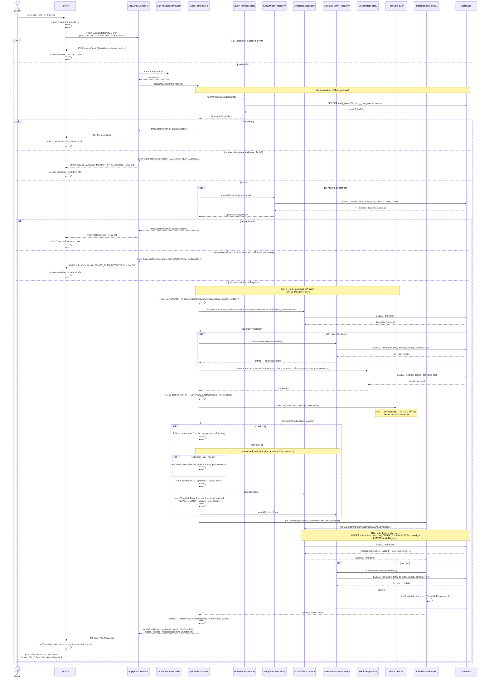

# US8-T06 — Sequence Diagram: ยืนยันจัดตารางตามแผนการเรียน (Confirm)

ลำดับการทำงานระหว่าง UI, API, repository (DAO) และ DB ของ `POST /api/timetable/apply-plan` แบบ `dryRun: false` ต่อจาก [Sequence Diagram ขั้น Preview](./US8-T06-Sequence-Diagram-Preview.md)

ข้อกำหนดที่ใช้ตาม [DTO & API Spec](../T05/US8-DTO-API-Spec.md) และ [API Class Diagram](../T05/US8-API-Class-Diagram.md):

- ใช้ endpoint, `ApplyPlanController` และ `ApplyPlanService.applyPlan` ตัวเดียวกับ Preview ต่างกันแค่ `dryRun: false` UI ส่ง `planId` และ `minorId` ชุดเดียวกับตอน preview
- **คำนวณใหม่ทั้งหมด** ไม่ใช้ผล preview ครั้งก่อน เพราะระหว่างนั้นตารางอาจถูกแก้ในแท็บอื่น ขั้นหา preset → `loadMinor` → `loadCandidates` → `planScheduler.schedule()` จึงเหมือน Preview ทุกขั้น รวมถึง error ของวิชาโท
- `ApplyPlanService.saveAdded` บันทึกเองผ่าน `TimetableRepository` และ `TimetableEntryRepository` **ไม่เรียก** `POST /api/timetable/entries` หรือ `TimetableService.addEntry` ของ US1 เพราะต้องบันทึก `added` ทั้งหมดใน transaction เดียว และ `PlanScheduler` ตรวจวิชาซ้ำ หน่วยกิต และเวลาชนครบแล้ว
- response คืน `timetable` เป็น `TimetableResponse` ที่สร้างด้วย `TimetableService.getTimetable` ของ US1 ใน transaction เดียวกัน frontend วาด grid ต่อได้เลยโดยไม่ต้อง GET ซ้ำ
- ชื่อ "DAO" ในการ์ดคือ repository เหมือน US1-T06 และ US2-T06

หมายเหตุ

- **all-or-nothing** การบันทึกทั้งหมดอยู่ใน transaction เดียวของ `applyPlan` ถ้า error ระหว่างทาง จะไม่มีวิชาไหนถูกเพิ่มค้างในตาราง error ของวิชาโท (`MINOR_NOT_ALLOWED`, 404, `MINOR_PLAN_MISMATCH`) เกิดก่อน `saveAdded` จึงไม่เขียน DB เลย
- **SQL ของการบันทึกส่งตอน flush** `save` / `saveAll` / `touch()` เปลี่ยนสถานะใน persistence context ก่อน Hibernate ส่ง `INSERT` / `UPDATE` ก่อน query ถัดไปใน `getTimetable` วิชาที่เพิ่มจึงอยู่ใน response และ `updatedAt` เป็นเวลาใหม่ (แบบเดียวกับ US2-T06)
- **ไม่เก็บว่าวิชามาจากวิชาโท** `source` มีเฉพาะใน `added` / `skipped` ของ response นี้ หลังบันทึกแล้ววิชาโทเป็น entry ปกติ ลบได้ผ่าน US2 และ `timetable` ใน response ไม่มีป้าย "วิชาโท"
- **`added` ว่างไม่เขียน DB** ไม่สร้างตารางใหม่และ `updatedAt` ไม่เปลี่ยน ยังตอบ `200` ถ้าไม่เคยมีตารางของภาคนั้น `getTimetable` คืนตารางว่างที่มี `updatedAt: null` ตาม US1
- **ผลอาจต่างจาก preview** ถ้าตารางถูกแก้ในแท็บอื่นระหว่าง preview กับยืนยัน UI ต้องแสดง `added` / `skipped` / `timetable` จาก response นี้ ไม่ใช่ผลของ preview
- **`timetable.conflicts` ยังมีได้** ถ้าตารางเดิมมีวิชาชนกันอยู่แล้วก่อน apply (US8 ไม่ลบวิชาเดิม) แต่วิชาที่ US8 เพิ่ม (ทั้ง `PLAN` และ `MINOR`) จะไม่ชนกับวิชาใดเลย
- **ไม่ใช้ API เพิ่มวิชาของ US1** `addEntry` ทำงานทีละ section, query ซ้ำ และสร้าง response ทุกรอบ อีกทั้งไม่ตรวจเวลาชน ส่วน `BusinessRuleException` ที่โยนจากในนั้นจะทำให้ transaction ของ `applyPlan` rollback ทั้งก้อน
- **400 จาก `@Valid`**, **400 จาก `BusinessRuleException`** และ **404 จาก `ResourceNotFoundException`** ถูกแปลงเป็น ProblemDetail โดย `GlobalExceptionHandler` เดิม

## เอกสารที่เกี่ยวข้อง

- [Extended API Class Diagram](./US8-T06-Extended-API-Class-Diagram.md)
- [DAO Class Diagram](./US8-T06-DAO-Class-Diagram.md)
- [ER Diagram (DB)](./US8-T06-ER-Diagram.md)
- [Sequence Diagram — ดูแผนการเรียน](./US8-T06-Sequence-Diagram-StudyPlans.md)
- [Sequence Diagram — Preview](./US8-T06-Sequence-Diagram-Preview.md)
- [DTO & API Spec](../T05/US8-DTO-API-Spec.md) (US8-T05)
- [DTO Class Diagram](../T05/US8-DTO-Class-Diagram.md) (US8-T05)
- [API Class Diagram](../T05/US8-API-Class-Diagram.md) (US8-T05)
- [US1-T06 — Sequence Diagram](../../US1/T06/US1-T06-Sequence-Diagram.md)
- [US2-T06 — Sequence Diagram](../../US2/T06/US2-T06-Sequence-Diagram.md)
