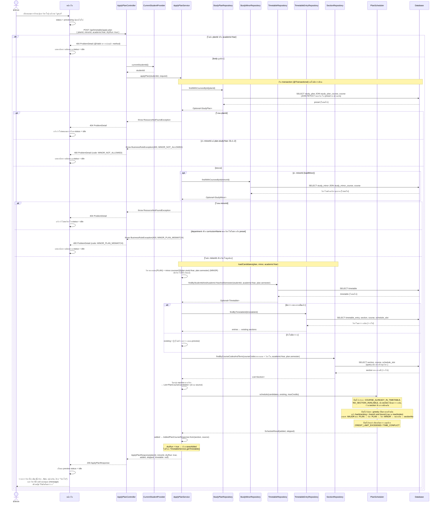

# US8-T06 — Sequence Diagram: ดูสรุปก่อนยืนยันจัดตาราง (Preview)

ลำดับการทำงานระหว่าง UI, API, repository (DAO) และ DB ของ `POST /api/timetable/apply-plan` แบบ `dryRun: true` ต่อจาก US8-T05 ขั้นกดยืนยัน (`dryRun: false`) อยู่ใน Sequence Diagram อีกไฟล์

ข้อกำหนดที่ใช้ตาม [DTO & API Spec](../T05/US8-DTO-API-Spec.md) และ [API Class Diagram](../T05/US8-API-Class-Diagram.md):

- endpoint อยู่ที่ `ApplyPlanController` ซึ่งแยกจาก `TimetableController` ของ US1 (ไม่แก้ controller เดิม) แล้วส่งต่อให้ `ApplyPlanService`
- `studentId` มาจาก JWT ผ่าน `CurrentStudentProvider` เหมือน US1 ไม่รับจาก body
- ภาคเรียนอ่านจาก `plan.semester` ของ preset ไม่ต้องส่งมาใน request แผน (หัวข้อพิเศษ/สหกิจ) บอกด้วย `planId` อยู่แล้ว
- `minorId` ไม่บังคับ ไม่ส่ง/`null` = ไม่เรียนวิชาโท วิชาโทใช้วิชาของ `plan.studyYear` + `plan.semester`
- **preview ไม่เขียน DB** service อ่านข้อมูลจาก DB เพื่อส่งให้ `PlanScheduler` ผล `added` / `skipped` มาจากการคำนวณในหน่วยความจำ และคืน `timetable: null` โดยไม่เรียก `TimetableService.getTimetable()`
- ลำดับใน `applyPlan`: หา preset (404) → `loadMinor` ถ้ามี `minorId` (400 `MINOR_NOT_ALLOWED` / 404 / 400 `MINOR_PLAN_MISMATCH`) → `loadCandidates` (รวมวิชา `PLAN` + `MINOR`, entry เดิม + section ของทุกวิชา) → `planScheduler.schedule()` → `dryRun` จึงคืนผลทันที
- ชื่อ "DAO" ในการ์ดคือ repository เหมือน US1-T06 และ US2-T06

หมายเหตุ

- **ไม่มีการเขียน DB ทุกกรณี** ไม่สร้าง `Timetable` แม้ยังไม่มีตารางของภาคนั้น ไม่ `touch()` และไม่บันทึก entry หลัง preview แล้ว `GET /api/timetable` จึงได้ผลเดิม (ตรงกับเทสต์ที่เสนอไว้ใน Spec)
- **`MINOR_NOT_ALLOWED` ตรวจก่อนหาวิชาโท** ใช้แค่ `plan.studyYear` จึงไม่ query `study_minor` ส่วน `MINOR_PLAN_MISMATCH` เทียบ `department` และ `curriculumName` ของวิชาโทกับ preset ทั้งสองแบบใช้ `BusinessRuleException` เดิม `handleBusinessRule` ใส่ `code` ลง ProblemDetail
- **วิชาโทที่ไม่มีวิชาในภาคของ preset ไม่ใช่ error** `coursesOf` คืนรายการว่าง ผลจึงเหมือนไม่เลือกวิชาโท แต่ `minorId` ยังส่งกลับตาม request
- **วิชาแผนหลักมาก่อนเสมอ** เกณฑ์ข้อ 1–2 นับเฉพาะ `PLAN` วิชาโทจึงไม่ทำให้วิชาของแผนหลักหลุด ถ้าชนหรือหน่วยกิตเกิน วิชาโทเป็นฝ่ายถูกข้าม (`skipped` พร้อม `source: "MINOR"`)
- **`added` ว่างไม่ใช่ error** ยังตอบ `200` และวิชาที่ลงไม่ได้อยู่ใน `skipped` เหตุผลรายวิชาไม่ใช่ HTTP error
- **`PlanScheduler` ไม่ยุ่งกับ DB** ทุก query เกิดใน `ApplyPlanService` ก่อนเรียก `schedule()` ส่วนการตรวจเวลาชนใช้ `ScheduleOverlap` ร่วมกับ US1 (ไม่ได้วาดเพื่อไม่ให้แผนภาพรก)
- **query ไม่ขึ้นกับจำนวนวิชา** ดึง section ของทุกวิชาในแผนและวิชาโทด้วย `findByCourseCodesAndTerm` ครั้งเดียว และ entry เดิมด้วย `findByTimetableId` ครั้งเดียว `open-in-view: false` จึงต้องโหลดข้อมูลที่ใช้มาครบใน query
- **ผล preview ใช้แสดงเท่านั้น** ตอนกดยืนยัน backend คำนวณใหม่ทั้งหมด (ระหว่างนั้นตารางอาจถูกแก้ในแท็บอื่น) ดู Sequence Diagram ขั้นยืนยัน
- **400 จาก `@Valid`**, **400 จาก `BusinessRuleException`** และ **404 จาก `ResourceNotFoundException`** ถูกแปลงเป็น ProblemDetail โดย `GlobalExceptionHandler` เดิม

## เอกสารที่เกี่ยวข้อง

- [Extended API Class Diagram](./US8-T06-Extended-API-Class-Diagram.md)
- [DAO Class Diagram](./US8-T06-DAO-Class-Diagram.md)
- [ER Diagram (DB)](./US8-T06-ER-Diagram.md)
- [Sequence Diagram — ดูแผนการเรียน](./US8-T06-Sequence-Diagram-StudyPlans.md)
- [Sequence Diagram — Confirm](./US8-T06-Sequence-Diagram-Confirm.md)
- [DTO & API Spec](../T05/US8-DTO-API-Spec.md) (US8-T05)
- [DTO Class Diagram](../T05/US8-DTO-Class-Diagram.md) (US8-T05)
- [API Class Diagram](../T05/US8-API-Class-Diagram.md) (US8-T05)
- [US1-T06 — Sequence Diagram](../../US1/T06/US1-T06-Sequence-Diagram.md)
- [US2-T06 — Sequence Diagram](../../US2/T06/US2-T06-Sequence-Diagram.md)
