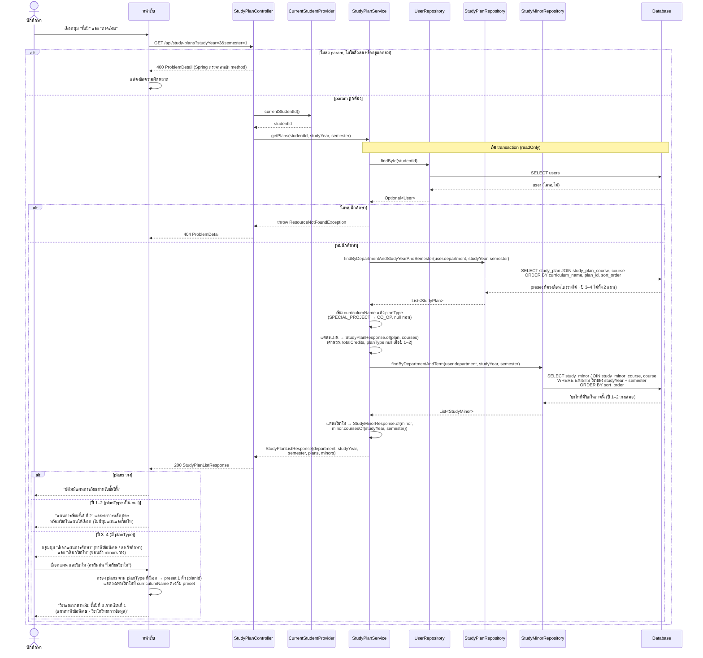

# US8-T06 — Sequence Diagram: ดูแผนการเรียนที่เลือกได้

ลำดับการทำงานระหว่าง UI, API, repository (DAO) และ DB ของ `GET /api/study-plans?studyYear=&semester=` ต่อจาก US8-T05 เป็นขั้นก่อน [Preview](./US8-T06-Sequence-Diagram-Preview.md) ให้นักศึกษาได้ `planId` (และ `minorId` ถ้าเลือกวิชาโท) ไปใช้

ข้อกำหนดที่ใช้ตาม [DTO & API Spec](../T05/US8-DTO-API-Spec.md) และ [API Class Diagram](../T05/US8-API-Class-Diagram.md):

- `studyYear` (1–4) และ `semester` (1–2) เป็น `@RequestParam` พร้อม `@Min` / `@Max` ค่าผิดหรือไม่ส่ง → 400 ก่อนเข้า method controller **ห้ามใส่ `@Validated`** (ไม่เช่นนั้นจะได้ 500) ไม่มี param `planType`
- backend ไม่คำนวณชั้นปี ใช้ `studyYear` ที่ส่งมาตรง ๆ และกรองด้วย `users.department` ของนักศึกษา
- ปี 3–4 ได้ preset ทั้ง 2 แผน (`SPECIAL_PROJECT`, `CO_OP`) ต่อหลักสูตรพร้อมกัน เรียงตาม `curriculumName` แล้ว `planType` frontend กรองตามปุ่มแผนที่เลือกเอง
- `minors` มีเฉพาะวิชาโทของ `department` ที่มีวิชาใน `studyYear` + `semester` นี้ และ `courses` ของวิชาโทเป็นเฉพาะวิชาของภาคนี้ ปี 1–2 ได้ `minors: []` เสมอ
- ไม่พบแผน → `200` กับ `plans: []` ไม่ใช่ error
- `StudyPlanService` เป็น `@Transactional(readOnly = true)` ไม่มีการเขียน
- ชื่อ "DAO" ในการ์ดคือ repository เหมือน US1-T06 และ US2-T06

หมายเหตุ

- **ต้องโหลดวิชาในแผนและวิชาโทมาใน query เดียวกันของแต่ละ repository** เพราะ `open-in-view: false` และ `StudyPlanResponse.of` / `StudyMinorResponse.of` อ่านวิชาของทุกแผน/วิชาโท ทั้ง request จึงมี 3 query (users, study_plan, study_minor) รายละเอียด `JOIN FETCH` อยู่ใน [DAO Class Diagram](./US8-T06-DAO-Class-Diagram.md)
- **เรียง `planType` ใน Java** เพราะ `plan_type` เก็บเป็นข้อความ ถ้าเรียงใน SQL จะได้ `CO_OP` ก่อน `SPECIAL_PROJECT`
- **วิชาโทโหลดวิชาครบทุกภาค** แล้วกรองด้วย `coursesOf(studyYear, semester)` ใน Java ไม่กรอง collection ที่ fetch ใน SQL ตรง ๆ (ดูเหตุผลใน DAO Class Diagram)
- **ปุ่มแผนและวิชาโทเป็นงานฝั่ง UI ทั้งหมด** ไม่ได้เรียก API เพิ่ม และไม่ได้บันทึกค่าที่เลือก เปลี่ยนภาคเรียนแล้ว UI จำ `planType` / `minorId` ไว้แล้วเรียก `GET` ใหม่ ถ้าภาคใหม่ไม่มีวิชาโทนั้นใน `minors` ให้กลับเป็น "ไม่เรียนวิชาโท" เปลี่ยนไปปี 1–2 ล้างทั้งแผนและวิชาโท
- **400 มี 3 แบบ** `MissingServletRequestParameterException`, `MethodArgumentTypeMismatchException` และ `HandlerMethodValidationException` ทั้งหมดจัดการโดย `ResponseEntityExceptionHandler` ที่ `GlobalExceptionHandler` สืบทอดมา ดูตาราง "Validation ของ query param" ใน API Class Diagram
- **404 เกิดได้น้อย** นักศึกษาที่ login แล้วมีแถวใน `users` เสมอ (US3) แต่ service ยังต้องกันกรณีนี้ไว้
- **`courses` ยังไม่บอกว่าภาคนี้เปิดสอนหรือไม่** ผลจริงดูจาก `apply-plan` แบบ `dryRun` ในขั้น Preview

## เอกสารที่เกี่ยวข้อง

- [Extended API Class Diagram](./US8-T06-Extended-API-Class-Diagram.md)
- [DAO Class Diagram](./US8-T06-DAO-Class-Diagram.md)
- [ER Diagram (DB)](./US8-T06-ER-Diagram.md)
- [Sequence Diagram — Preview](./US8-T06-Sequence-Diagram-Preview.md)
- [Sequence Diagram — Confirm](./US8-T06-Sequence-Diagram-Confirm.md)
- [DTO & API Spec](../T05/US8-DTO-API-Spec.md) (US8-T05)
- [API Class Diagram](../T05/US8-API-Class-Diagram.md) (US8-T05)
