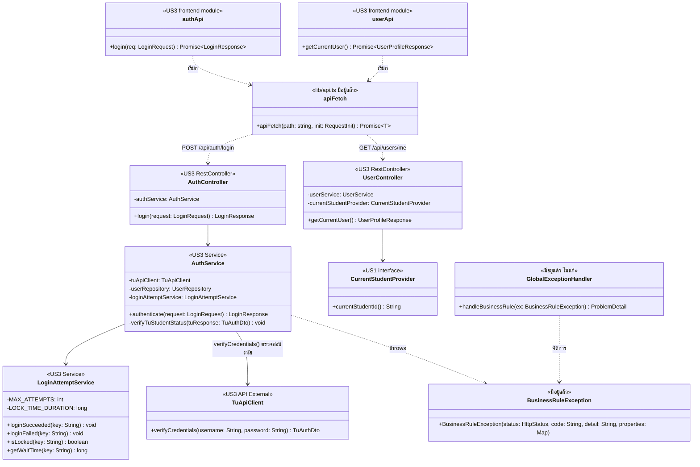

# US3 — API Class Diagram

US3 เพิ่ม controller กับ service ใหม่ฝั่ง backend ใน package `auth` และ `user` และโมดูลเรียก API ฝั่ง frontend แผนภาพวาด class ของ US3 (`<<US3>>`) กับจุดที่พึ่งระบบเดิมและของที่มีอยู่แล้ว โดยไม่แก้ `GlobalExceptionHandler` และ `CurrentStudentProvider`

    | ส่วน | หน้าที่ |
    | --- | --- |
    | AuthController | @RestController @RequestMapping("/api/auth") · login = POST /login ทั้งสองตอบ 200 หน้าที่หลักคือรับส่งข้อมูล Request/Response ของการเข้าสู่ระบบไปให้ AuthService จัดการต่อ |
    | UserController | @RestController @RequestMapping("/api/users") · getCurrentUser = GET /me ตอบ 200 ขอ studentId จาก CurrentStudentProvider แล้วสร้าง UserProfileResponse เพื่อส่งชื่อ-นามสกุลไปแสดงที่ Navbar|
    | AuthService | @Transactional ที่ระดับ class · ตรวจสอบเงื่อนไขตามลำดับ: ตรวจสอบการถูกล็อคบัญชี (429) → ยิงตรวจสอบกับ TU Login API (ถ้ารหัสผิด โยน 401 + นับ Attempt) → ตรวจสถานะนักศึกษา CS ภาคปกติ (403) → เคลียร์ Attempt เมื่อสำเร็จ → บันทึก/อัปเดตลงตาราง User → คืนค่า JWT Token |
    | LoginAttemptService | @Service ใช้ ConcurrentHashMap หรือ Redis ในการเก็บ Cache · นับจำนวนครั้งที่เข้าสู่ระบบผิดพลาด หาก loginFailed() ครบ 5 ครั้ง ฟังก์ชัน isLocked() จะคืนค่า true ทันทีเป็นเวลา 15 นาที พร้อมคำนวณเวลาที่เหลือด้วย getWaitTime() เป็นวินาทีส่งให้ Frontend |
    | TuApiClient | โมดูลยิง HTTP Request (RestTemplate หรือ WebClient) ไปยัง TU Login API ของมหาวิทยาลัย เพื่อตรวจสอบ Username และ Password ว่าถูกต้องหรือไม่ และนำข้อมูลที่ได้รับกลับมาเพื่อตรวจสอบสิทธิ์ต่อไป |
    | CurrentStudentProvider | (จาก US1) ให้ studentId ของผู้ใช้ปัจจุบัน ใน US3 ต้องสร้าง Implementation ตัวใหม่ (เช่น SecurityContextStudentProvider) ให้อ่านจาก Spring Security Context หรือ JWT Token แทนค่า Demo โดยที่ Interface เดิมไม่ต้องแก้ เพื่อให้ US1 และ US2 ใช้งานต่อได้อัตโนมัติ |
    | BusinessRuleException | (มีอยู่แล้ว) จัดการ Error ของระบบทั้งหมด โยน Error พร้อม HTTP Status Code, สตริง code (เช่น INVALID_CREDENTIALS), และ Map Properties (เช่นแนบค่า retryAfterSeconds ไปใน Body) |
    | GlobalExceptionHandler | (มีอยู่แล้ว) ดักจับ BusinessRuleException ให้ออกมาเป็นโครงสร้าง ProblemDetail (RFC 9457) ให้ Frontend |
    | authApi / userApi | frontend/features/auth/api.ts และ users/api.ts · ส่ง Body ไปตาม Endpoint แปลง Error เป็น ApiError ให้ UI นำไปสลับหน้า State ตาม Error Code |

    สัญลักษณ์: + = public, - = private · field ทุกตัวเป็น private final ฉีดผ่าน constructor ด้วย @RequiredArgsConstructor ตามแบบของโปรเจกต์ · ไม่มี # เพราะ class ใหม่ของ US3 ไม่มีการสืบทอด · เส้นทึบ = เรียกใช้ผ่าน field, เส้นประ = throws / จัดการ exception / เรียกผ่าน HTTP
